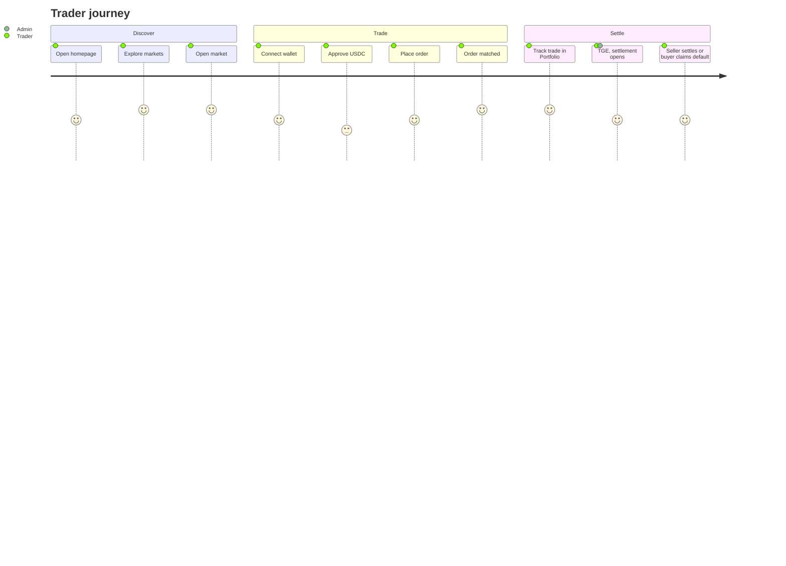
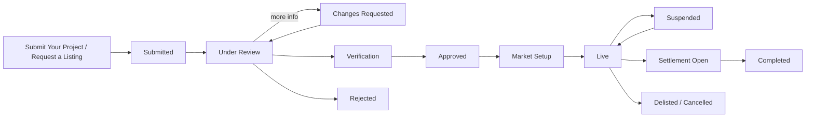

# Avantdex — Product Requirements Document (PRD)

## Document information

| | |
|---|---|
| **Product** | Avantdex — pre-market trading marketplace on Arc Network |
| **Version** | 1.0 (Arc **Testnet** MVP) |
| **Date** | 2026-11-03 |
| **Owner** | Avantdex product owner |
| **Companion document** | [R&D.md](R&D.md) — rationale, research and sources for every decision below |
| **Network** | Arc Testnet, chain ID 5042002, RPC `https://rpc.testnet.arc.io`, explorer `https://explorer.testnet.arc.io` |
| **Settlement asset** | USDC ERC-20 `0x3600000000000000000000000000000000000000`, **6 decimals** (verified against Arc docs and the testnet RPC on 2026-11-01/03) |
| **Platform fee collector** | `0x136a2C17E0E6C077F48F489BeC6DBCE3202CEbd6` |
| **Audit status** | **Not audited.** No requirement below may be presented to users as "audited" or "safe". |

**Legend.** Priority uses MoSCoW: **M**ust, **S**hould, **C**ould, **W**on't (in MVP). `[ASSUMPTION]` = needs confirmation. `[LEGAL]` = needs legal review. "Implemented" in §41 states what the repository actually contains; a requirement existing here does not mean it is implemented.

---

## Table of contents

1. [Product overview](#1-product-overview)
2. [Product vision](#2-product-vision)
3. [Objectives](#3-objectives)
4. [Target users](#4-target-users)
5. [User personas](#5-user-personas)
6. [User stories](#6-user-stories)
7. [User journey](#7-user-journey)
8. [Platform fees (confirmed)](#8-platform-fees-confirmed)
9. [Functional requirements](#9-functional-requirements)
10. [Non-functional requirements](#10-non-functional-requirements)
11. [Homepage requirements](#11-homepage-requirements)
12. [Explore Markets requirements](#12-explore-markets-requirements)
13. [Market Details requirements](#13-market-details-requirements)
14. [Trading and order management requirements](#14-trading-and-order-management-requirements)
15. [Order book requirements](#15-order-book-requirements)
16. [Portfolio requirements](#16-portfolio-requirements)
17. [Wallet requirements](#17-wallet-requirements)
18. [Project submission requirements](#18-project-submission-requirements)
19. [Community listing request requirements](#19-community-listing-request-requirements)
20. [Project verification requirements](#20-project-verification-requirements)
21. [Admin dashboard requirements](#21-admin-dashboard-requirements)
22. [Market activation requirements](#22-market-activation-requirements)
23. [Escrow requirements](#23-escrow-requirements)
24. [Settlement requirements](#24-settlement-requirements)
25. [Dispute handling requirements](#25-dispute-handling-requirements)
26. [Notification requirements](#26-notification-requirements)
27. [Search and filtering requirements](#27-search-and-filtering-requirements)
28. [Database and data model requirements](#28-database-and-data-model-requirements)
29. [API requirements](#29-api-requirements)
30. [Smart contract requirements](#30-smart-contract-requirements)
31. [Security requirements](#31-security-requirements)
32. [Analytics and monitoring](#32-analytics-and-monitoring)
33. [Error handling](#33-error-handling)
34. [Empty states and loading states](#34-empty-states-and-loading-states)
35. [Legal, risk and compliance](#35-legal-risk-and-compliance)
36. [Acceptance criteria (release gates)](#36-acceptance-criteria-release-gates)
37. [MVP scope](#37-mvp-scope)
38. [Future development scope](#38-future-development-scope)
39. [Dependencies](#39-dependencies)
40. [Risks and constraints](#40-risks-and-constraints)
41. [Implementation status](#41-implementation-status)
42. [Open questions and decisions needing confirmation](#42-open-questions-and-decisions-needing-confirmation)
43. [Release and deployment plan](#43-release-and-deployment-plan)

---

## 1. Product overview

Avantdex is a **pre-market trading marketplace**. Users discover upcoming token markets, place buy and sell orders on an order book, manage a portfolio, and settle according to predefined market rules after the token launch (TGE). Money rules (escrow, matching validity, settlement, fees) are enforced by a smart contract on Arc; discovery, project workflows, verification and notifications are off-chain.

Key terms:

| Term | Definition |
|---|---|
| **Market** | A tradable pre-TGE market for one project token, identified on-chain by a numeric market id |
| **Lot** | The smallest tradable quantity; `lotSize` token base units |
| **Price** | USDC (6 decimals) per lot, a multiple of the market tick size |
| **Order** | A buy or sell instruction with funds locked on-chain |
| **Trade** | The result of matching a buy and a sell at the maker's price; escrowed until settlement |
| **TGE** | Token Generation Event — the token launch |
| **Settlement** | Atomic exchange of the project token (seller → buyer) against escrowed USDC |
| **Collateral** | USDC the seller locks equal to the trade value; forfeited to the buyer on default |
| **Default** | Seller does not deliver before the settlement deadline |
| **Create Listing** | Submitting/requesting that a **project** be listed — **not** creating an order |
| **Create Order** | Placing a buy/sell order from a market card or market page |

## 2. Product vision

`[CONFIRMED]` A professional, simple, intuitive and premium pre-market trading experience. The homepage stays minimal; advanced functionality lives in dedicated pages, tabs, modals and dashboards. Security and transparent settlement come before feature count.

## 3. Objectives

| ID | Objective | Measure (testnet MVP) |
|---|---|---|
| OBJ-001 | Users can trade through an order book with partial fills | End-to-end test: place → match → partial fill → settle passes |
| OBJ-002 | Settlement rules are transparent and enforced on-chain | All exits (settle, default, refund) are contract functions with tests |
| OBJ-003 | Admins cannot take users' escrowed funds | No contract function lets any role withdraw escrow; verified by tests |
| OBJ-004 | Listings go through approval → verification → activation as separate steps | Status machine in §18–§22 enforced by API and contract |
| OBJ-005 | 0.5 % + 0.5 % fee on successful trades only, paid to the collector | Fee tests pass; collector balance equals Σ fees |
| OBJ-006 | Chain and database stay consistent | Index replay from block 0 reproduces identical orders/trades |

## 4. Target users

| Role | Description |
|---|---|
| Trader (buyer/seller) | Connects a wallet, places orders, settles |
| Project owner / team representative | Submits a project for listing |
| Community member | Requests a listing for a project they do not own |
| Admin roles | Super Admin, Project Reviewer, Verification Admin, Market Manager, Settlement Manager, Support Admin |
| Visitor | Browses markets without a wallet |

## 5. User personas

| Persona | Goal | Needs |
|---|---|---|
| **Aisha, pre-launch trader** | Buy allocation she expects to be valuable at TGE | Clear order book, exact cost including fee, refund guarantees |
| **Rahim, early holder** | Sell part of an expected allocation before TGE | Understand collateral, deadlines, and default consequences |
| **Mei, project lead** | Get her project listed with credible badges | Clear submission form, status tracking, honest badge definitions |
| **Omar, market manager** | Configure and activate markets safely | Checklist, on-chain activation, audit trail |
| **Sara, support admin** | Help users with issues | Read-only user/order lookup, dispute tickets, no fund powers |

## 6. User stories

| ID | Story | Priority |
|---|---|---|
| US-001 | As a visitor I can browse markets and the order book without connecting a wallet | M |
| US-002 | As a trader I can connect an injected wallet on Arc Testnet and see my USDC balance | M |
| US-003 | As a buyer I can place a limit buy order and see the exact USDC (payment + 0.5 % fee) that will be locked | M |
| US-004 | As a seller I can place a limit sell order and see the collateral that will be locked | M |
| US-005 | As a trader I can place a market-style order only with a price cap and minimum fill | M |
| US-006 | As a trader I can cancel any open order and get a full refund with no fee | M |
| US-007 | As a seller I can settle a trade after settlement opens and receive payment minus 0.5 % plus my collateral | M |
| US-008 | As a buyer I can claim the default (payment + seller collateral) after the deadline | M |
| US-009 | As a project owner I can submit my project and track its status | M |
| US-010 | As a community member I can request a listing | M |
| US-011 | As a reviewer I can approve, reject or request changes to applications | M |
| US-012 | As a market manager I can configure a market and activate it on-chain | M |
| US-013 | As a user I can see all my orders, trades and settlement status with transaction hashes | M |
| US-014 | As an admin I can see an audit log of every admin action | M |
| US-015 | As a user I can read what each verification badge does and does not guarantee | M |

## 7. User journey

## 8. Platform fees (confirmed)

`[CONFIRMED]` by the product owner. Fees are paid in USDC to the **platform fee collection address `0x136a2C17E0E6C077F48F489BeC6DBCE3202CEbd6`**.

| Action | Fee |
|---|---|
| Buyer (successful trade) | **0.5 %** |
| Seller (successful trade) | **0.5 %** |
| Unfilled order cancellation | **0 %** |
| Project listing | **0 %** |
| Community listing request | **0 %** |
| Failed transaction | **0 %** platform fee |

| ID | Requirement | Priority |
|---|---|---|
| FEE-001 | "Successful trade" means a trade that reaches status **Settled**. Fees are computed from the trade value and charged **only** at settlement. | M |
| FEE-002 | Buyer fee = `floor(value × 50 / 10 000)`, locked in addition to the payment when the order is placed/filled; returned in full if the trade does not settle. | M |
| FEE-003 | Seller fee = `floor(value × 50 / 10 000)`, deducted from the seller's payout at settlement. | M |
| FEE-004 | Cancelling an unfilled or partly filled order returns the entire remaining lock; fee 0. | M |
| FEE-005 | Project submission and community listing requests are free (no on-chain or off-chain charge). | M |
| FEE-006 | Defaults, cancelled markets, abandoned markets and reverted transactions charge **no** platform fee. Arc network gas is separate and not a platform fee. | M |
| FEE-007 | Fees are paid to the fee collector in the same transaction as settlement. If the collector cannot receive USDC, the amount is credited as claimable and settlement still succeeds. | M |
| FEE-008 | The UI shows the fee in USDC before the user signs an order, and again in the trade detail after settlement. | M |
| FEE-009 | The fee rates are contract constants; only the collector address is changeable, by `DEFAULT_ADMIN_ROLE`, with an event. | M |
| FEE-010 | Fee total per market and overall are visible to admins (indexed from events). | S |

Acceptance: see AC-FEE in §36.

## 9. Functional requirements

### 9.1 Authentication and wallet (AUTH)

**Feature description.** Wallet connection for trading; wallet-signature login for off-chain features.
**User role.** Trader, project owner, admin.
**User story.** US-002.

| ID | Requirement | Priority |
|---|---|---|
| AUTH-001 | The app connects injected wallets on Arc Testnet; if the wallet is on another network, the UI requests a switch. | M |
| AUTH-002 | Off-chain actions (submit project, request listing, notifications, admin) require a signed login message containing domain, address, nonce, issued-at and expiry. | M |
| AUTH-003 | Nonces are single-use and expire in 10 minutes; sessions expire in 12 hours (admin 2 hours). | M |
| AUTH-004 | Signing in never grants token approvals or moves funds. | M |
| AUTH-005 | Signature verification supports EOA wallets; contract wallets (ERC-1271) are `[ASSUMPTION]` not supported in MVP. | W |

**Expected behaviour.** Click Connect → choose wallet → approve → address shown; sign in only when an off-chain feature needs it.
**Validation.** Address must be a valid EVM address; chain ID 5042002.
**Error states.** Wallet missing; wrong network; user rejected; nonce expired; signature mismatch.
**Security.** Replay protection (nonce), domain binding, expiry.
**Acceptance.** AC-AUTH-1 replayed signature is rejected; AC-AUTH-2 expired nonce is rejected.
**Dependencies.** Wallet extension, API.

## 10. Non-functional requirements

| ID | Requirement | Priority |
|---|---|---|
| NFR-001 | Chain reads for funds-related state (balances, allowance, order status shown right before signing) come directly from the chain, not only the DB. | M |
| NFR-002 | The indexer processes new blocks within 15 seconds under normal conditions; indexer lag is exposed at `/api/health` and in the UI footer. | M |
| NFR-003 | API p95 latency < 500 ms for market list/order book with ≤ 1 000 open orders (measured locally). | S |
| NFR-004 | The frontend works on current Chromium/Firefox/Safari, from 360 px width. | M |
| NFR-005 | Keyboard-accessible controls, visible focus, sufficient contrast (WCAG 2.1 AA as a target). | S |
| NFR-006 | The production frontend is a static bundle served by nginx; no secrets in the bundle. | M |
| NFR-007 | Testnet and mainnet configurations are separate; no mainnet address exists in the repository. | M |
| NFR-008 | Reproducible deployment with Docker Compose (PostgreSQL, API, indexer, web). | M |
| NFR-009 | All money amounts use integer base units; no floating-point in contract or DB. | M |

## 11. Homepage requirements

`[CONFIRMED]` The homepage remains minimal and premium. It contains only:

1. Avantdex logo and **Arc Network** badge.
2. **Search Tokens** box.
3. **Wallet connection**.
4. **Explore** card and **Portfolio** card.
5. **Marketplace** section: *Available Markets*, **Explore All**, market cards with **Buy** and **Sell** buttons.
6. **Create Listing** section with exactly two options: **Submit Your Project** and **Request a Listing**.

| ID | Requirement | Priority |
|---|---|---|
| HOME-001 | The homepage has no "Create Order" call-to-action. Buy/Sell on a market card opens the market page with the corresponding order side selected. | M |
| HOME-002 | Create Listing offers exactly two options and never opens an order form. | M |
| HOME-003 | Market cards show only real, indexed data. If there are no markets, an empty state is shown. | M |
| HOME-004 | Search Tokens filters by project name/symbol and navigates to Explore with the query. | M |
| HOME-005 | No additional homepage sections (stats walls, banners) are added in the MVP. | M |

Acceptance: AC-HOME-1 homepage contains no element labelled "Create Order"; AC-HOME-2 with an empty database, no market card is rendered and the empty state appears.

## 12. Explore Markets requirements

| ID | Requirement | Priority |
|---|---|---|
| MARKET-001 | Tabs: **All Markets, Trending, New Listings, Upcoming TGE, Closing Soon, Settled**. | M |
| MARKET-002 | *Trending* = highest 24 h traded volume; *New Listings* = most recently activated; *Upcoming TGE* = TGE date in the future, sorted ascending; *Closing Soon* = trading end within 7 days; *Settled* = status Completed. | M |
| MARKET-003 | Search by name/symbol; category filter; market status filter; sorting (volume, newest, TGE date, best bid, best ask). | M |
| MARKET-004 | Cards may show: logo, project name, token symbol, pre-market price (last trade price), best bid, best ask, 24 h volume, open interest, TGE date, market status, verification badges. | M |
| MARKET-005 | A field with no data shows "—", never a fabricated number. | M |
| MARKET-006 | Open interest = sum of values of trades in status Open (USDC). | S |

Acceptance: AC-MARKET-1 each tab returns only markets satisfying its rule; AC-MARKET-2 a market with no trades shows "—" for price and 0 for volume.

## 13. Market Details requirements

| ID | Requirement | Priority |
|---|---|---|
| MD-001 | Header: logo, name, symbol, status, verification badges (with explanations), TGE date, network, contract address links. | M |
| MD-002 | Tabs/sections: Order Book, Recent Trades, About (project info), Rules (fees, collateral, settlement, deadlines). | M |
| MD-003 | Trade panel: Buy/Sell toggle, Limit/Market(IOC) toggle, price, quantity (lots), expiry, cost breakdown (value, fee, total locked), allowance state, submit. | M |
| MD-004 | The Rules section states the fee table (§8) and that default forfeits seller collateral to the buyer. | M |
| MD-005 | If the market is not `Live`, the trade panel is disabled with the reason shown. | M |
| MD-006 | A visible notice states that badges do not imply safety, profitability or guaranteed delivery. | M |

## 14. Trading and order management requirements

**Feature description.** Place, match, cancel and expire orders.
**User role.** Trader.
**User story.** US-003 – US-006.

| ID | Requirement | Priority |
|---|---|---|
| ORDER-001 | Order types: **Limit** (rests on the book) and **Market-style** (immediate-or-cancel with price cap and minimum fill). A pure market order without a price cap is **not** offered. | M |
| ORDER-002 | Placing an order locks funds on-chain: buy → `value + fee`; sell → `value` collateral. | M |
| ORDER-003 | Matching: the taker supplies maker order ids; the contract executes crossings at the **maker's price**, up to the available quantity, with partial fills. | M |
| ORDER-004 | Orders have an expiry no later than the market's trading end; after expiry an order can no longer be matched and funds are returned on cleanup/cancel. | M |
| ORDER-005 | The owner can cancel an open order at any time (market suspended, cancelled, settlement, contract paused) — full refund. | M |
| ORDER-006 | Self-trading is rejected on-chain. | M |
| ORDER-007 | Order states: Open, Partially Filled, Filled, Cancelled, Expired. | M |
| ORDER-008 | A submitted order is **never** shown as executed until its transaction receipt succeeds and the event is indexed. Pending, confirmed and failed states are shown. | M |
| ORDER-009 | Price must be a multiple of the market tick; lots between market min and max; order value ≥ 1 USDC `[ASSUMPTION]`. | M |
| ORDER-010 | Slippage control: market-style orders require `minFillLots`; the transaction reverts if less is filled. | M |
| ORDER-011 | Market-specific limits (min/max lots, tick size) are shown next to the form and validated before signing. | M |

**Expected behaviour.** The UI computes the maker list from the order book endpoint (best price first, oldest first), simulates the call, shows the cost, then asks the wallet to sign.
**Validation.** On-chain validation is authoritative; UI pre-validation mirrors it.
**Error states.** Market not live; invalid tick; size out of range; insufficient allowance; insufficient balance; maker no longer open; nothing filled (IOC).
**Security.** Funds locked by the contract; no operator signature needed; reentrancy protection; no native value.
**Acceptance.** AC-ORDER-1 buy 10 lots against a resting sell of 6 lots at lower price → 6 lots executed at the maker price, 4 lots rest; AC-ORDER-2 cancel returns exact lock; AC-ORDER-3 IOC with `minFillLots` unmet reverts and moves no funds.
**Dependencies.** Exchange contract, indexer, USDC.

## 15. Order book requirements

| ID | Requirement | Priority |
|---|---|---|
| BOOK-001 | Display aggregated bids (descending) and asks (ascending) by price level with total lots and cumulative depth. | M |
| BOOK-002 | Show best bid, best ask, spread, last price. | M |
| BOOK-003 | Recent trades list with price, lots, time, transaction link. | M |
| BOOK-004 | Market depth visualisation (cumulative bars). | S |
| BOOK-005 | 24 h volume and total volume per market. | M |
| BOOK-006 | Clicking a price level pre-fills the trade form. | S |
| BOOK-007 | The book shows only on-chain open, unexpired orders; its source and "last updated block" are visible. | M |
| BOOK-008 | The user's own orders are highlighted. | S |

## 16. Portfolio requirements

**User story.** US-013. Tabs: **Overview, Open Orders, My Buy Orders, My Sell Orders, Partially Filled, Filled, Cancelled, Expired, Trade History, Settlement Status, Completed Transactions**.

| ID | Requirement | Priority |
|---|---|---|
| PORT-001 | Overview: USDC balance, locked in orders, locked in trades, claimable balance, open trade count. | M |
| PORT-002 | Each order row links to a detail view: id, market, side, price, lots, filled, status, expiry, transaction hash(es). | M |
| PORT-003 | Each trade shows role (buyer/seller), value, fee (if settled), status, settlement deadline, tx hashes. | M |
| PORT-004 | Settlement Status tab lists trades awaiting action with the available action (Settle / Claim default / Refund). | M |
| PORT-005 | Claimable balance with a Withdraw action. | M |
| PORT-006 | Data is shown by connected wallet only; the page requires a wallet connection and shows an empty state otherwise. | M |
| PORT-007 | Export history (CSV). | C |

## 17. Wallet requirements

| ID | Requirement | Priority |
|---|---|---|
| WALLET-001 | Connect, disconnect, switch account; show shortened address and USDC balance. | M |
| WALLET-002 | Network guard for Arc Testnet; one-click switch. | M |
| WALLET-003 | Gas: transactions use `maxFeePerGas` ≥ 20 gwei (Arc guidance). | M |
| WALLET-004 | Approvals request the exact needed allowance, not unlimited, unless the user chooses "approve more". | M |
| WALLET-005 | Faucet link to `faucet.circle.com` when balance is insufficient. | M |
| WALLET-006 | Transaction states: wallet confirmation → pending → success/failed with explorer link. | M |

## 18. Project submission requirements

**Feature description.** "Submit Your Project" — for project owners and authorised representatives.
**User role.** Project owner.
**User story.** US-009.

| ID | Requirement | Priority |
|---|---|---|
| LIST-001 | Form fields: project name, token name and symbol, logo URL, description, official website, official social links, blockchain, token contract address (optional pre-TGE), supply information, allocation information, TGE information (date, status), documentation links, ownership/authorisation evidence, team wallet. | M |
| LIST-002 | Required to submit: name, symbol, description, website, at least one social link, blockchain, TGE information, ownership/authorisation evidence, team wallet. | M |
| LIST-003 | The applicant signs in with the **team wallet** (signature) to prove control of that wallet; this proves wallet control only. | M |
| LIST-004 | Applications start as **Draft** (editable), become **Submitted** on submit; the applicant can track status and respond to **Changes Requested**. | M |
| LIST-005 | No file uploads in MVP; evidence is URLs/hashes. | M |
| LIST-006 | Submitting is free (0 %). | M |
| LIST-007 | Submitting never creates a market. | M |

**Validation.** Symbol 1–12 `A–Z0–9`; URLs must be `https://`; address must be a valid EVM address when provided; description ≤ 2 000 chars; all text is stored and rendered as plain text.
**Error states.** Missing fields; duplicate symbol; unsigned session; rate-limited.
**Security.** Output escaping; URL allow-list; rate limit (e.g., 5 submissions/hour/wallet); no HTML.
**Acceptance.** AC-LIST-1 invalid fields are rejected with field-level errors; AC-LIST-2 a submitted application never appears in `/markets`.

### 18.1 Application statuses

`[CONFIRMED]` list: Draft, Submitted, Under Review, Verification, Changes Requested, Approved, Rejected, Market Setup, Live, Suspended, Delisted, Completed.

| Status | Meaning | Allowed next | Who |
|---|---|---|---|
| Draft | Applicant is editing | Submitted | Applicant |
| Submitted | Awaiting reviewer | Under Review, Rejected | Reviewer |
| Under Review | Being assessed | Verification, Changes Requested, Rejected | Reviewer |
| Verification | Facts being checked (contract, allocation, ownership) | Approved, Changes Requested, Rejected | Verification Admin |
| Changes Requested | Waiting for applicant | Submitted (re-submit) | Applicant |
| Approved | Accepted for market setup (**not** a live market) | Market Setup, Rejected | Reviewer |
| Rejected | Declined with reason | — (new application) | Reviewer |
| Market Setup | Market parameters being configured | Live, Approved | Market Manager |
| Live | Market is active on-chain | Suspended, Completed, Delisted | Market Manager |
| Suspended | Trading paused | Live, Delisted | Market Manager |
| Delisted | Removed from discovery; exits remain open | — | Market Manager |
| Completed | Settlement finished | — | Market Manager |

| ID | Requirement | Priority |
|---|---|---|
| STATUS-001 | Transitions not listed above are rejected by the API (HTTP 409) and logged. | M |
| STATUS-002 | Every transition stores actor, reason and timestamp in `project_status_history` and `audit_logs`. | M |
| STATUS-003 | **Approval, verification and market activation are three separate actions** with separate permissions. Approval never activates a market. | M |
| STATUS-004 | The on-chain market status is the source of truth for Live/Suspended/Completed; the DB mirrors it from events. | M |

## 19. Community listing request requirements

**Feature description.** "Request a Listing" for ordinary users.
**User role.** Any connected user. **User story.** US-010.

| ID | Requirement | Priority |
|---|---|---|
| REQ-001 | Fields: project name, token symbol, official website or social link, reason for requesting. | M |
| REQ-002 | A request **never** creates a market. An admin may convert it into an invitation/contact outreach or reject/close it. | M |
| REQ-003 | Requests are free, rate-limited (5/day/wallet) and deduplicated by symbol (shows existing request count). | M |
| REQ-004 | Status: Open, Under Review, Closed (Declined/Duplicate/Converted). | M |
| REQ-005 | Reason ≤ 1 000 chars; plain text only. | M |

Acceptance: AC-REQ-1 a request does not appear in `/markets`; AC-REQ-2 only admins with the right role can change request status.

## 20. Project verification requirements

`[CONFIRMED]` Three separate badges.

| Badge | Means | Does **not** mean |
|---|---|---|
| **Verified Project** | A reviewer confirmed the applicant's control of the official website/social accounts or a project-signed statement, and the identity of the team wallet | The team is trustworthy, the project will succeed, or tokens will exist |
| **Contract Verified** | The token contract address was confirmed by the project through an official channel, and the contract source is verified on the Arc explorer (where available) | The contract is audited, free of bugs or free of admin powers |
| **Allocation Verified** | Allocation/supply figures were compared with official project documentation | The allocation is final, locked, or will be delivered |

| ID | Requirement | Priority |
|---|---|---|
| VERIFY-001 | Badges are granted only by `verification_admin` or `super_admin`, each with evidence notes and an optional expiry. | M |
| VERIFY-002 | Each badge shows an explanation popover with the table above. | M |
| VERIFY-003 | A visible disclaimer states that no badge implies investment safety, profitability or guaranteed token delivery. | M |
| VERIFY-004 | Badge grant/revoke is audit-logged and shows date and verifier role (not personal data). | M |
| VERIFY-005 | Revoking a badge is immediate; existing trades are unaffected. | M |

## 21. Admin dashboard requirements

Separate route group (`/admin`), restricted by signed login + off-chain role.

Modules: **Overview, Applications, Verification, Approved Projects, Live Markets, Market Management, Settlement Management, Disputes, Users, Admin Roles, Audit Logs, Settings**.

| Role | Responsibilities | Must not |
|---|---|---|
| Super Admin | Manage roles, settings, everything below | Move user funds (no such function exists) |
| Project Reviewer | Review applications and listing requests | Grant badges or activate markets |
| Verification Admin | Run verification and grant/revoke badges | Activate markets |
| Market Manager | Configure/activate/suspend/cancel markets (also needs the on-chain `MARKET_MANAGER_ROLE` wallet) | Approve applications |
| Settlement Manager | Open/extend settlement, monitor deadlines (on-chain `MARKET_MANAGER_ROLE`) | Alter trades |
| Support Admin | Read users/orders; manage dispute tickets | Change statuses, badges, markets |

| ID | Requirement | Priority |
|---|---|---|
| ADMIN-001 | Admin routes require a valid admin session and a role permitting the specific action (checked server-side for every request). | M |
| ADMIN-002 | Overview shows counts: applications by status, live markets, open trades, indexer lag, fee totals. | M |
| ADMIN-003 | Applications module: list, filter by status, open detail, transition with reason, request changes. | M |
| ADMIN-004 | Verification module: per-project badge grant/revoke with evidence. | M |
| ADMIN-005 | Live Markets / Market Management: market parameters, status, suspend/resume/cancel via on-chain transactions signed by the manager wallet. | M |
| ADMIN-006 | Settlement Management: list markets awaiting settlement, open settlement (token address + window), extend (bounded), complete. | M |
| ADMIN-007 | Disputes: tickets with notes and status; **no action here moves funds**. | M |
| ADMIN-008 | Users: wallet list with first/last seen, order/trade counts; no personal data beyond wallet. | S |
| ADMIN-009 | Admin Roles: grant/revoke off-chain roles (Super Admin only); shows on-chain role holders read from the contract. | M |
| ADMIN-010 | Audit Logs: filterable, append-only, shows actor, action, entity, before/after. | M |
| ADMIN-011 | Settings: read-only display of contract address, fee collector, fee rates, chain; editable platform notice text. | S |
| ADMIN-012 | **Two-person approval** for sensitive actions (open settlement, cancel market, change fee collector). MVP records a second approver on the audit log for off-chain steps; on-chain enforcement requires a multisig/timelock which is **not** implemented in the MVP deployment. | S |
| ADMIN-013 | Multisig as `DEFAULT_ADMIN_ROLE` holder is recommended for any value-bearing launch. | S |

**Security.** No admin UI element or API can withdraw escrow; admin sessions are short; every mutation is logged.
**Acceptance.** AC-ADMIN-1 a Project Reviewer cannot grant a badge (403); AC-ADMIN-2 every status change produces an audit log row; AC-ADMIN-3 non-admin wallets get 403 on `/admin/*`.

## 22. Market activation requirements

`[CONFIRMED]` Approval does not activate a market. Activation is a separate configuration and activation process.

| Field | Source |
|---|---|
| Market ID | On-chain (sequential) |
| Project ID | DB link via `metadata_ref` |
| Token information | Project (symbol, name, decimals) |
| Token contract address | Set at `openSettlement` (unknown pre-TGE) or pre-set when known `[ASSUMPTION]` |
| Avantdex market contract address | The Exchange contract |
| Trading pair | `TOKEN/USDC` |
| Network | Arc Testnet |
| Min / max order size | Lots |
| Tick size | USDC base units per lot |
| Quantity precision | `lotSize` (token base units per lot) |
| Trading fees | 0.5 % buyer + 0.5 % seller (constants) |
| Trading start time / trading end | Timestamps |
| Expiry rules | Orders expire ≤ trading end |
| TGE date | Informational (DB) |
| Settlement conditions | Window length (1 h–14 d), bounded extension, default rule |

Process (all mandatory, in order):

1. Project in **Approved** status (reviewer).
2. **Market Setup**: manager fills the configuration in the dashboard (stored as DRAFT in DB).
3. **Deployment/testing**: for the MVP the exchange is one shared contract — "deployment" means `createMarket` on-chain; testing means placing and cancelling a small test order on Arc Testnet.
4. **Configuration verification**: the dashboard reads the market back from the chain and compares every parameter with the DB draft; mismatch blocks activation.
5. **Final admin activation**: a second authorised admin approves; the manager wallet sends `activateMarket`.

| ID | Requirement | Priority |
|---|---|---|
| ACT-001 | `createMarket` stores `metadata_ref = keccak256(slug)`; the indexer binds on-chain market to the DB record. | M |
| ACT-002 | Activation is impossible while any chain/DB parameter mismatch exists (UI check). | M |
| ACT-003 | Parameters (tick, lot size, min/max, trading window) are immutable after creation; to change them, cancel and create a new market. | M |
| ACT-004 | Suspend/resume available while trading; settlement/refund/cancel exits always remain. | M |
| ACT-005 | A market's trading start must be in the future or now; trading end ≥ start + 1 hour. | M |

Acceptance: AC-ACT-1 a project in Approved status has no on-chain market until a manager creates one; AC-ACT-2 mismatched parameters block the Activate button.

## 23. Escrow requirements

| ID | Requirement | Priority |
|---|---|---|
| ESCROW-001 | Funds are held by the Exchange contract; each order and trade records exactly what is locked. | M |
| ESCROW-002 | No role (admin, manager, pauser, fee collector) can withdraw or redirect escrowed funds. | M |
| ESCROW-003 | Solvency invariant: contract USDC balance ≥ Σ order locks + Σ open-trade escrow + Σ claimable. | M |
| ESCROW-004 | Payouts that fail (blocklist) become claimable; `withdrawClaimable` is open to the account only. | M |
| ESCROW-005 | The Exchange handles no native value (no `receive`; `msg.value` rejected). | M |
| ESCROW-006 | If a market is never settled, anyone can trigger refunds after `tradingEnd + 90 days` (abandon path). | M |

## 24. Settlement requirements

**Feature description.** Atomic settlement at TGE, default claim, and refunds.
**User roles.** Seller, buyer, settlement manager.
**User stories.** US-007, US-008.

| ID | Requirement | Priority |
|---|---|---|
| SETTLE-001 | Settlement opens only when a market manager calls `openSettlement(marketId, tokenAddress, windowSeconds)` with a contract address; window 1 hour – 14 days; trading stops. | M |
| SETTLE-002 | **Settle:** only the seller; moves `lots × lotSize` tokens from seller to buyer and verifies the buyer's balance increase equals the expected amount; then pays seller `2×value − sellerFee` (payment + collateral − fee), pays `buyerFee + sellerFee` to the collector. | M |
| SETTLE-003 | Settlement is **atomic**: if the token transfer or verification fails, nothing moves. | M |
| SETTLE-004 | **Default claim:** only the buyer, after `settlementDeadline`; buyer receives `value + buyerFee` plus the seller's collateral; no platform fee. | M |
| SETTLE-005 | The seller may settle after the deadline until the buyer claims default. | M |
| SETTLE-006 | **Extension:** a manager may extend the deadline once or more, but the new deadline must be later than the current one and no later than `settlementOpenedAt + 30 days`. | M |
| SETTLE-007 | **Cancelled market:** every trade is refundable by anyone: buyer gets `value + buyerFee`, seller gets collateral; no fee, no penalty. | M |
| SETTLE-008 | A market can be marked Completed only when no trade is Open. | M |
| SETTLE-009 | The UI shows deadlines as absolute time with a countdown; time zone shown. | M |
| SETTLE-010 | The seller UI checks token approval and balance before sending the settle transaction and explains missing steps. | M |

**Expected behaviour.** Seller Portfolio → Settlement Status → Settle (approve token if needed). Buyer sees "waiting for seller" until the deadline, then a **Claim default** button.
**Validation.** Trade must be Open; market status; deadline checks; seller identity.
**Error states.** Token not approved; insufficient token balance; delivery verification failed; settlement not open; too early to claim.
**Security.** Reentrancy guard; state changes before external calls; balance-delta verification.
**Acceptance.** AC-SETTLE-1 seller settles → buyer receives exact token amount, seller receives `2×value − fee`, collector receives total fees; AC-SETTLE-2 default claim before deadline reverts, after deadline pays buyer payment + collateral; AC-SETTLE-3 fee-on-transfer token causes settle to revert with no state change.

## 25. Dispute handling requirements

| ID | Requirement | Priority |
|---|---|---|
| DISPUTE-001 | Users may open a dispute ticket from a trade (reason, evidence links). | M |
| DISPUTE-002 | Tickets are **off-chain** and **cannot move funds**; on-chain outcomes (settle/default/refund) are deterministic. | M |
| DISPUTE-003 | Support Admin/Super Admin can add notes, change status (Open, In Review, Resolved, Rejected). | M |
| DISPUTE-004 | The Rules page explains what can and cannot be disputed (e.g., price movement is not a dispute reason; wrong-token-address issues are escalated to market suspension). | M |
| DISPUTE-005 | Where a manager action (e.g., wrong token address) is shown to be the cause, remedy is by suspending/cancelling the market, never by moving funds. | M |
| DISPUTE-006 | On-chain arbitration. | W |

## 26. Notification requirements

| ID | Requirement | Priority |
|---|---|---|
| NOTIF-001 | In-app notifications generated from indexed events: order matched/partially filled, order expired/cancelled, trade created, settlement opened, deadline in 24 h, trade settled, default claimed, refund available. | M |
| NOTIF-002 | Notification list with unread count; mark as read. | M |
| NOTIF-003 | Email/push/Telegram notifications. | W |
| NOTIF-004 | Notifications never contain secrets and link to the relevant page and transaction hash. | M |

## 27. Search and filtering requirements

| ID | Requirement | Priority |
|---|---|---|
| SEARCH-001 | Search by project name and symbol (case-insensitive, prefix and substring). | M |
| SEARCH-002 | Filters: category, market status, TGE date range, verification badge. | M |
| SEARCH-003 | Sorting: volume, newest, TGE date, best bid/ask. | M |
| SEARCH-004 | Query and filters are reflected in the URL for sharing. | S |

## 28. Database and data model requirements

PostgreSQL 16. Tables are listed in [R&D §26](R&D.md#26-database-design-considerations-postgresql).

| ID | Requirement | Priority |
|---|---|---|
| DATA-001 | All money values are `NUMERIC(78,0)` base units. | M |
| DATA-002 | `chain_events` has a unique `(tx_hash, log_index)` for idempotent indexing. | M |
| DATA-003 | Rebuilding the DB from chain events yields the same `orders`/`trades` state (replay test). | M |
| DATA-004 | `audit_logs` are insert-only for the application role. | M |
| DATA-005 | Schema changes only via Alembic migrations. | M |
| DATA-006 | No private keys, seed phrases or API secrets are ever stored. | M |
| DATA-007 | Personal data limited to wallet addresses and optional contact text typed by users. | M |

## 29. API requirements

Base path `/api`. JSON. Public endpoints need no auth; user endpoints need a session; admin endpoints need a role.

| ID | Endpoint | Description |
|---|---|---|
| API-001 | `GET /health` | API, DB, indexer lag |
| API-002 | `POST /auth/nonce`, `POST /auth/verify`, `POST /auth/logout`, `GET /auth/me` | Wallet-signature login |
| API-003 | `GET /config` | Chain id, contract address, USDC address, fee constants, fee collector (public, non-secret) |
| API-004 | `GET /markets`, `GET /markets/{id}` | Markets with filters/tabs/sorting |
| API-005 | `GET /markets/{id}/orderbook`, `/trades`, `/stats` | Book, recent trades, volume |
| API-006 | `GET /portfolio/{address}/orders`, `/trades`, `/summary` | Wallet data (public chain data) |
| API-007 | `POST /projects`, `PUT /projects/{id}`, `POST /projects/{id}/submit`, `GET /projects/mine` | Applicant flow |
| API-008 | `POST /listing-requests`, `GET /listing-requests/summary` | Community requests |
| API-009 | `GET /notifications`, `POST /notifications/{id}/read` | In-app notifications |
| API-010 | `POST /disputes`, `GET /disputes/mine` | Tickets |
| API-011 | `/admin/*` | Applications, transitions, badges, markets, settlement, disputes, users, roles, audit logs, settings |

| ID | Requirement | Priority |
|---|---|---|
| API-100 | Errors use a consistent JSON shape `{ "error": { "code", "message" } }` with correct HTTP codes (400/401/403/404/409/422/429). | M |
| API-101 | Rate limiting on auth and write endpoints. | M |
| API-102 | Input validated by typed schemas; unknown fields rejected. | M |
| API-103 | CORS limited to configured origins; same-origin proxy in production. | M |
| API-104 | OpenAPI documentation generated. | S |

## 30. Smart contract requirements

Contract: `AvantdexExchange` (details in [R&D §14–§21](R&D.md#14-smart-contract-architecture)).

| ID | Requirement | Priority |
|---|---|---|
| SC-001 | Solidity 0.8.28, OpenZeppelin 5, Foundry; no upgradeability, no `delegatecall`. | M |
| SC-002 | Roles: `DEFAULT_ADMIN_ROLE`, `MARKET_MANAGER_ROLE`, `PAUSER_ROLE`. | M |
| SC-003 | `BUYER_FEE_BPS = 50`, `SELLER_FEE_BPS = 50`, `feeCollector` initial value `0x136a2C17E0E6C077F48F489BeC6DBCE3202CEbd6` set at deployment. | M |
| SC-004 | Events for every state change for the indexer: MarketCreated, MarketStatusChanged, SettlementOpened, SettlementExtended, OrderPlaced, OrderCancelled, TradeExecuted, TradeSettled, TradeDefaulted, TradeRefunded, FeeCollected, ClaimableCredited, ClaimableWithdrawn, FeeCollectorUpdated. | M |
| SC-005 | `maxFeePerGas` guidance is enforced client-side (not by the contract). | M |
| SC-006 | Arrays supplied by callers are capped at 50. | M |
| SC-007 | Timestamp comparisons tolerate non-strictly increasing timestamps. | M |
| SC-008 | Test suite covering every function and revert path, fuzz tests and a solvency invariant. | M |

## 31. Security requirements

| ID | Requirement (measurable) | Priority |
|---|---|---|
| SECURITY-001 | No contract function allows a privileged role to move escrowed USDC (verified by test and code review). | M |
| SECURITY-002 | Every state-changing, fund-moving function has `nonReentrant` and updates state before external calls. | M |
| SECURITY-003 | All token pulls verify exact balance deltas. | M |
| SECURITY-004 | Login nonces are single-use, expire in 10 min; sessions are signed tokens (HS256 with a random 32-byte secret from environment) expiring in ≤ 12 h. | M |
| SECURITY-005 | Every `/admin` route checks role server-side; automated tests assert 401/403 for unauthenticated/unauthorised calls. | M |
| SECURITY-006 | Secrets (JWT secret, DB password, deployer key) are never committed; `.env` is git-ignored; only `.env.example` with placeholders is committed. | M |
| SECURITY-007 | User-supplied text is stored as plain text and escaped on render; URLs must be `https://` and are rendered with `rel="noopener noreferrer"`. | M |
| SECURITY-008 | Security headers on the web server (nosniff, referrer policy, frame options). | M |
| SECURITY-009 | Dependencies pinned via lockfiles; `pip`/`bun` installs reproducible. | M |
| SECURITY-010 | Rate limiting on auth and form endpoints. | M |
| SECURITY-011 | Do not claim audits. The footer states "Testnet — unaudited". | M |
| SECURITY-012 | Independent audit before any mainnet use. | M (pre-mainnet) |

## 32. Analytics and monitoring

| ID | Requirement | Priority |
|---|---|---|
| MON-001 | `/health` returns DB connectivity, last indexed block, chain head, lag. | M |
| MON-002 | Structured logs for API and indexer (JSON), no secrets. | M |
| MON-003 | Product analytics (privacy-preserving, no third-party trackers) are out of MVP. | W |
| MON-004 | Admin Overview shows Σ fees collected per market (from indexed `FeeCollected`). | S |

## 33. Error handling

| ID | Requirement | Priority |
|---|---|---|
| ERR-001 | Contract custom errors are mapped to human-readable messages in the UI. | M |
| ERR-002 | User-rejected wallet requests return to idle without an error banner. | M |
| ERR-003 | A mined-but-reverted transaction shows "reverted on-chain" with the explorer link. | M |
| ERR-004 | API errors show a retry option; indexer lag shows a stale-data warning. | M |
| ERR-005 | Unknown errors show a generic message and a correlation id; details are logged server-side. | S |

## 34. Empty states and loading states

| ID | Requirement | Priority |
|---|---|---|
| UX-001 | Skeleton loaders for market grid, order book, portfolio. | M |
| UX-002 | Empty states: no markets, empty order book ("No orders yet — place the first one"), no trades, empty portfolio tabs, no notifications. | M |
| UX-003 | Disabled buttons always show the reason (e.g., "Connect wallet", "Market not live", "Approve USDC first"). | M |

## 35. Legal, risk and compliance

`[LEGAL]` — all documents below must be drafted and reviewed by qualified counsel. The product ships **draft placeholder pages** labelled "Draft — not legal advice". No legal entity, address, jurisdiction, restricted-country list, regulatory approval or compliance certification is stated anywhere in the product.

| ID | Requirement | Priority |
|---|---|---|
| LEGAL-001 | Pages (placeholders): Terms & Conditions, Privacy Policy, Risk Disclosure, Cookie Policy, Listing Policy, Trading & Settlement Rules. | M |
| LEGAL-002 | Risk disclosure includes: unaudited testnet software; seller may default; token may never launch; price volatility; blocklist risk on USDC; verification badges are not guarantees. | M |
| LEGAL-003 | First-use acknowledgement checkbox for the risk disclosure before the first order (stored client-side). | S |
| LEGAL-004 | Restricted jurisdictions and eligibility rules: to be defined by counsel. | `[LEGAL]` |
| LEGAL-005 | Cookie banner only if non-essential cookies are used (none in MVP). | M |

## 36. Acceptance criteria (release gates)

| ID | Test | Pass condition |
|---|---|---|
| AC-FEE-1 | Settle a trade of value V | Collector receives exactly `2 × floor(V×50/10000)`; buyer paid `V + fee`; seller received `2V − fee` |
| AC-FEE-2 | Cancel an unfilled order | Owner gets the full lock back; collector balance unchanged |
| AC-FEE-3 | Default claim | Buyer receives `V + fee + V`; collector unchanged |
| AC-FEE-4 | Cancel market → refund | Each party refunded in full; collector unchanged |
| AC-FEE-5 | Collector blocklisted | Settlement succeeds; amount appears in `claimable` |
| AC-ESCROW-1 | Random sequences of orders/fills/cancels/settles (fuzz) | Solvency invariant never violated |
| AC-ESCROW-2 | Any role calls any function | No call reduces another user's escrow or claimable |
| AC-ORDER-* | See §14 | Pass |
| AC-SETTLE-* | See §24 | Pass |
| AC-ADMIN-* | See §21 | Pass |
| AC-HOME-* | See §11 | Pass |
| AC-LIST-* / AC-REQ-* | See §18–§19 | Pass |
| AC-IDX-1 | Drop DB, replay events from deployment block | Orders and trades equal the pre-drop state |
| AC-E2E-1 | Browser run on a local chain: create market → place sell → place buy → partial fill → open settlement → settle → portfolio shows Settled with tx hashes | Pass |

## 37. MVP scope

| Area | MoSCoW | In MVP |
|---|---|---|
| Wallet connect + SIWE login | M | Yes |
| Markets, explore tabs, search/filter | M | Yes |
| Market page, order book, trades, depth | M | Yes (depth: simple bars) |
| Limit + market-style (IOC) orders, partial fills, cancel, expiry | M | Yes |
| Escrow, settlement, default, refunds, claimable | M | Yes |
| 0.5 % + 0.5 % fees to collector | M | Yes |
| Project submission + listing request + status machine | M | Yes |
| Verification badges | M | Yes |
| Admin dashboard (12 modules) | M | Yes (see §41 for depth) |
| Notifications (in-app) | M | Yes |
| Disputes (off-chain tickets) | M | Yes |
| PostgreSQL + indexer + API | M | Yes |
| Legal placeholder pages | M | Yes |
| Multisig/timelock enforcement | S | No (recommended) |
| File uploads, email notifications, CSV export | C/W | No |
| Mainnet, cross-chain, leverage, resale of positions, referral, token | W | No |

## 38. Future development scope

Resale of open positions; cross-chain settlement; multisig + timelock for admin actions; on-chain order priority enforcement; EIP-2612/Permit2 approvals `[OPEN]`; email/push notifications; analytics; mobile; external audit; fee discounts; partial collateral models.

## 39. Dependencies

Arc Testnet RPC and USDC; wallet extensions; faucet for test USDC; PostgreSQL 16; Docker; Foundry; Python 3.12; Bun/Node for the frontend; a deployer wallet funded on Arc Testnet (owned by the product owner, never shared in chat or committed).

## 40. Risks and constraints

| Risk / constraint | Note |
|---|---|
| Unaudited contract | Testnet only |
| Fake token address at settlement | Process controls required (§20 of R&D) |
| Low liquidity | Expected on a new product |
| Small deploy server | Frontend is prebuilt; services are lightweight |
| Legal uncertainty | Counsel required before real value |
| Foundry cannot fork Arc USDC | Mock + live testnet verification |
| Admin power over token address | Mitigated by role separation and recommended multisig |

## 41. Implementation status

This section is updated with facts, not intentions.

| Item | Status |
|---|---|
| R&D.md, PRD.md | Written (this document set) |
| `AvantdexExchange` + Foundry tests | Implemented; see test results in the repository history/README |
| Backend (FastAPI + PostgreSQL + indexer) | Implemented |
| Frontend | Implemented |
| Local end-to-end test | Run on a local chain; results in the final report |
| Arc Testnet deployment | **Requires the owner's funded wallet**; deploy script and instructions provided. Until then, the deployed contract address placeholders in `.env.example` must be replaced. |
| Audit, legal review, multisig, timelock | Not done |

## 42. Open questions and decisions needing confirmation

1. Is the fee collector `0x136a…Ebd6` an address you control and can recover? (Immutable fee rates; collector changeable by admin.)
2. Collateral ratio 100 % of trade value acceptable for the MVP? (R&D §32.)
3. Default settlement window length per market (proposed: 24 h; configurable 1 h – 14 d).
4. Minimum order value of 1 USDC.
5. Who holds `DEFAULT_ADMIN_ROLE`, `MARKET_MANAGER_ROLE`, `PAUSER_ROLE` on testnet (deployer by default)?
6. Categories list for projects (proposed: DeFi, Infrastructure, AI, Gaming, RWA, Payments, Other).
7. Legal documents, eligibility rules, restricted jurisdictions.
8. Whether to keep AllocX v1 contracts in the repository (kept under `contracts/` as legacy).

## 43. Release and deployment plan

| Stage | Environment | Actions | Exit criteria |
|---|---|---|---|
| 1. Local | Anvil + PostgreSQL (Docker) | Run contract tests, backend tests, local end-to-end | AC-E2E-1 passes |
| 2. Arc Testnet | Arc Testnet | Owner deploys the exchange from their funded wallet; sets addresses in `.env`; creates a test market with a mock token; trades; settles | Testnet runbook completed |
| 3. Hosting | Coolify (Docker Compose) | `docker compose up` with PostgreSQL, API, indexer, web (static, prebuilt) | Health endpoint green; indexer lag < 15 s |
| 4. Hardening | — | External audit, legal review, multisig/timelock | Findings resolved |
| 5. Mainnet | Arc Mainnet (chain 5042) | **Not planned until stage 4 is complete** | Product owner decision |

Rollback: the contract is immutable; on a serious issue, suspend/cancel markets (refunds open) and redeploy a fixed contract under a new address. Database migrations are forward-only with backups before each release.
