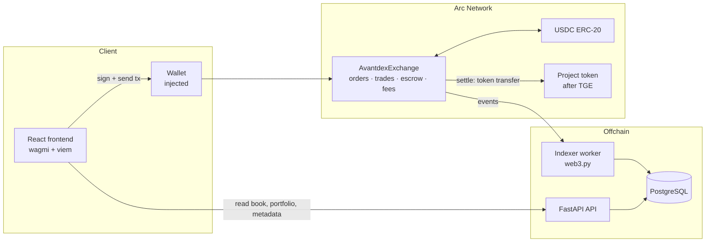
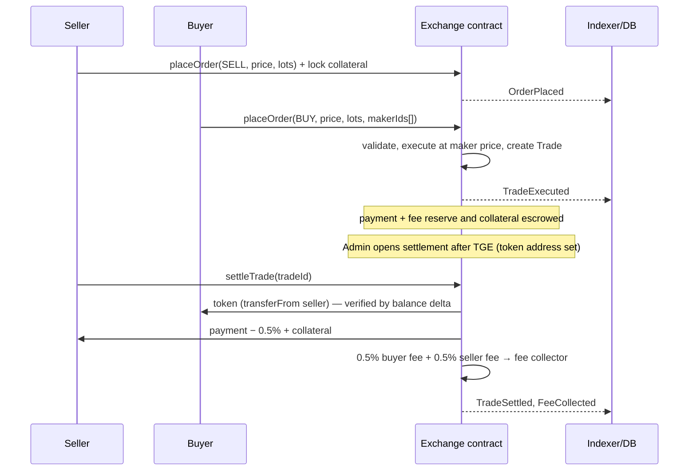
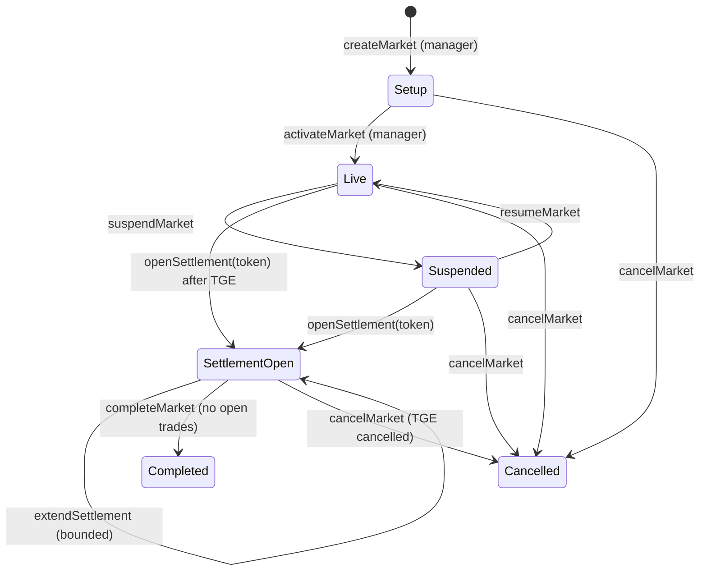
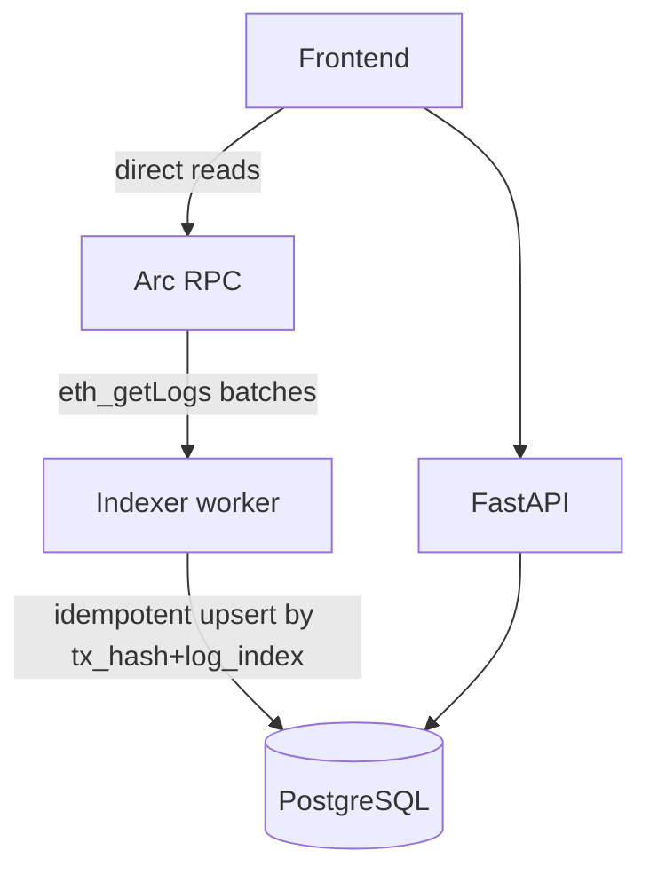

# Avantdex — Research & Development Document

| | |
|---|---|
| **Product** | Avantdex — pre-market trading marketplace on Arc Network |
| **Document** | R&D (technical research and architecture recommendation) |
| **Version** | 1.0 (testnet MVP) |
| **Date** | 2026-11-03 |
| **Companion** | [PRD.md](PRD.md) (requirements) — every requirement ID there traces back to a decision here |
| **Status of code** | The MVP described in §14–§17 is implemented on **Arc Testnet only**. Nothing in this repository has been audited. See [§21](#21-testing-and-audit-strategy). |

**Conventions.** `[CONFIRMED]` = confirmed product decision (from `project_requirements.md` or the product owner). `[VERIFIED]` = checked against a primary source (cited). `[ASSUMPTION]` = reasonable default, needs confirmation. `[LEGAL]` = needs qualified legal review. `[OPEN]` = unresolved research question.

---

## Table of contents

1. [Executive summary](#1-executive-summary)
2. [Project background](#2-project-background)
3. [Product vision](#3-product-vision)
4. [Problem statement](#4-problem-statement)
5. [Market research](#5-market-research)
6. [Competitor analysis](#6-competitor-analysis)
7. [Pre-market trading models](#7-pre-market-trading-models)
8. [Order book architecture research](#8-order-book-architecture-research)
9. [Centralized vs decentralized vs hybrid order book](#9-centralized-vs-decentralized-vs-hybrid-order-book)
10. [Recommended architecture](#10-recommended-architecture)
11. [Arc Network technical research](#11-arc-network-technical-research)
12. [USDC integration considerations](#12-usdc-integration-considerations)
13. [Platform fee model](#13-platform-fee-model)
14. [Smart contract architecture](#14-smart-contract-architecture)
15. [Escrow architecture](#15-escrow-architecture)
16. [Matching engine research](#16-matching-engine-research)
17. [Partial fill implementation](#17-partial-fill-implementation)
18. [Order cancellation and expiry](#18-order-cancellation-and-expiry)
19. [Settlement architecture](#19-settlement-architecture)
20. [Token delivery verification](#20-token-delivery-verification)
21. [TGE delay and failed delivery handling](#21-tge-delay-and-failed-delivery-handling)
22. [Admin and governance architecture](#22-admin-and-governance-architecture)
23. [Security threat model](#23-security-threat-model)
24. [Smart contract security requirements](#24-smart-contract-security-requirements)
25. [Indexer and backend architecture](#25-indexer-and-backend-architecture)
26. [Database design considerations (PostgreSQL)](#26-database-design-considerations-postgresql)
27. [Frontend architecture](#27-frontend-architecture)
28. [Wallet integration](#28-wallet-integration)
29. [Scalability and performance](#29-scalability-and-performance)
30. [Legal and regulatory research considerations](#30-legal-and-regulatory-research-considerations)
31. [Development risks](#31-development-risks)
32. [Technical challenges](#32-technical-challenges)
33. [Recommended technology stack](#33-recommended-technology-stack)
34. [Development roadmap](#34-development-roadmap)
35. [Testing and audit strategy](#35-testing-and-audit-strategy)
36. [Open research questions](#36-open-research-questions)
37. [Final technical recommendations](#37-final-technical-recommendations)
38. [Sources](#38-sources)

---

## 1. Executive summary

Avantdex lets users trade **claims on tokens that do not exist yet** (pre-TGE) against USDC on Arc Network. A buyer and a seller agree on a price through an order book. Both lock USDC in a smart contract: the buyer locks the payment, the seller locks collateral equal to the trade value. After the project's token launch (TGE) the seller delivers the token **atomically** — token and payment move in one transaction — or the buyer is refunded and keeps the seller's collateral.

Key conclusions of this research:

| # | Conclusion | Reason |
|---|---|---|
| 1 | Use a **hybrid** design: all money rules on-chain, discovery/metadata/workflows off-chain | Keeps funds trust-minimised without putting search, KYC-style review and notifications on-chain |
| 2 | Keep **resting orders on-chain** (funds locked at placement); the off-chain indexer only *displays* them | Satisfies "never present an off-chain order as an on-chain guaranteed order" |
| 3 | Use **taker-supplied maker lists** for matching, execution at the **maker's price** | Cheap on-chain matching; no sorted on-chain book; both sides price-protected |
| 4 | Settle by **atomic token-for-payment swap** with balance-delta verification | Removes the largest class of pre-market disputes (claimed-but-undelivered tokens) |
| 5 | Charge **0.5 % buyer + 0.5 % seller only on successful (settled) trades**; 0 % on cancellations, listings, failures | Matches the fee table in the product requirements; collected into a dedicated fee collector address |
| 6 | **Admins can never move escrowed funds**; they can only open/suspend/cancel markets and set the token address, and every exit path stays open to users | Required by the requirements; also bounds the damage of a compromised admin |
| 7 | **PostgreSQL** holds metadata, applications, verification, indexed chain state and audit logs; **the chain stays the source of truth** | Requirement: keep blockchain state and DB state consistent |
| 8 | Arc finality is deterministic, so the indexer needs **no re-org handling** | [VERIFIED] Arc docs, §11 |

Everything here is a recommendation for a **testnet MVP**. Mainnet launch is explicitly out of scope until an independent audit and legal review are complete.

## 2. Project background

Pre-market (pre-TGE) trading is an established niche in crypto: traders buy and sell token allocations or points before a token is listed, which gives early price discovery. Avantdex brings this to Arc Network, Circle's EVM-compatible Layer-1 where USDC is the native gas token.

`[CONFIRMED]` Core requirements (from `project_requirements.md`): a full order-book model, a hybrid listing model (project submission + community request), a separate admin dashboard, separate project approval / verification / market activation, three verification badges, a portfolio dashboard, escrow-based settlement with refund and dispute handling, and a minimal premium homepage.

The repository previously contained **AllocX v1**, a simpler list-and-buy escrow marketplace (still deployed on Arc Testnet, contracts preserved under `contracts/`). Avantdex is a different product (order book + TGE settlement) and replaces the v1 frontend. This is recorded so the repository history is not misread.

## 3. Product vision

`[CONFIRMED]` A professional, simple, intuitive, premium trading experience. The homepage stays visually minimal; advanced functionality lives in dedicated pages, tabs, modals and dashboards. Safety and transparent settlement take priority over feature count.

Non-goals for the MVP: derivatives/leverage, cross-chain settlement, token launchpad functions, fiat on-ramps, mobile apps, governance token.

## 4. Problem statement

1. **Price discovery before launch is fragmented**: OTC chats and spreadsheets with no enforceable settlement.
2. **Counterparty risk**: a seller can promise tokens and vanish; a buyer can refuse to pay.
3. **Opaque rules**: users cannot verify who controls funds, or what happens if a launch is delayed or cancelled.
4. **Listing quality**: anyone can claim a token will exist; users need clear signals about what has and has not been verified.

Avantdex addresses (2) with collateralised escrow, (3) with predefined on-chain exit paths, and (4) with separated approval/verification/activation and explicit badge semantics.

## 5. Market research

Primary-source research was limited to what could be verified on 2026-11-03.

* Pre-market platforms describe a model in which **buyer and seller both lock collateral**, trading is price discovery rather than a guaranteed forward, and the seller may deliver or **default and forfeit collateral** ([Whales Market — Settlement Rules](https://docs.whales.market/pre-market/settlement-rules), accessed 2026-11-03).
* Arc is positioned as a stablecoin-native EVM Layer-1; USDC is the gas token; finality is deterministic ([Arc docs — EVM differences](https://docs.arc.io/arc/references/evm-differences), accessed 2026-11-03).
* `[OPEN]` Market-size and volume statistics for pre-market trading were **not** collected from primary sources and are intentionally omitted rather than estimated.

## 6. Competitor analysis

Only one competitor was researched from primary documentation. Others are listed as candidates for follow-up (`[OPEN]`) — **no claims are made about them**.

### 6.1 Whales Market `[VERIFIED]`

| Aspect | Whales Market (per docs, accessed 2026-11-03) | Avantdex decision |
|---|---|---|
| Collateral | Buyer and seller lock collateral in smart contracts | Same idea: buyer locks payment + fee, seller locks 100 % of trade value |
| Settlement window | Documented as a 4-hour window starting at activation | Configurable per market (1 hour – 14 days), set when settlement opens |
| Seller choice | Seller may **settle** or **default** and lose collateral | Same; default = collateral goes to the buyer |
| Late settlement | If the window passes, the buyer may cancel; if not cancelled the seller may still settle | Same rule: seller can settle until the buyer claims the default |
| Fees | Percentage fees on settlement and a separate resell fee (pages disagree on exact figures; check live docs) | 0.5 % buyer + 0.5 % seller **on successful settlement only**; no resale feature in MVP |
| Cross-chain | Supported via LayerZero | Out of scope for MVP |
| Delivery proof | Seller sends tokens and posts a tx hash; status moves to Settled after confirmations | **Atomic swap on-chain** — no tx-hash claims to verify |

Do not copy blindly: Avantdex chooses atomic settlement, bounded admin powers and a published fee table.

### 6.2 Other candidates `[OPEN]`

Exchange-run pre-markets and on-chain pre-launch perpetuals exist but were not researched. Before launch, research: fee schedules, collateral ratios, cancellation rules, dispute outcomes, and any publicly reported settlement failures.

## 7. Pre-market trading models

| Model | How it works | Advantages | Disadvantages | Risks | Fit |
|---|---|---|---|---|---|
| **A. Collateralised OTC order book (chosen)** | Orders on a book; each fill creates a trade with buyer payment + seller collateral escrowed; token delivered at TGE | Familiar; enforceable; transparent exit rules | Seller can default when TGE price spikes | Collateral sizing; delayed TGE | High |
| B. Perpetual/pre-launch perps | Synthetic price tracking, margin engine | Deep liquidity, leverage | Needs oracle, liquidations, much more complexity | Oracle manipulation | Low (out of scope) |
| C. Bonding-curve / AMM | Price from a curve | Always-on liquidity | Not an order book; conflicts with requirements | Impermanent loss, manipulation | None |
| D. Request-for-quote / negotiated | One-to-one deals | Simple | No market depth | Low liquidity | Low |

**Recommendation:** Model A. **Reason:** matches the confirmed order-book requirement and keeps settlement rules simple enough to verify and test.

## 8. Order book architecture research

Options for where the book lives:

1. **Fully on-chain book** (sorted storage, on-chain matching).
2. **Off-chain book with signed orders** (users sign EIP-712 messages; a relayer matches and submits).
3. **On-chain orders, off-chain index** (orders are on-chain with funds locked; the book is rebuilt from events; matching is done on-chain with caller-supplied makers).

| Criterion | 1. Fully on-chain sorted | 2. Off-chain signed | 3. On-chain orders + index (chosen) |
|---|---|---|---|
| Funds guaranteed at order time | Yes | **No** (order may be unfunded) | Yes |
| Gas per order | High (sorted insert) | Low (sign only) | Medium |
| Needs trusted operator | No | Yes (matching/relaying) | No |
| Complexity | High | Medium–high | Medium |
| "Off-chain order shown as guaranteed" risk | None | High | None |

`[CONFIRMED]` requirement: *"Never present an off-chain order as an on-chain guaranteed order."* Option 2 cannot satisfy this without extra escrow, so it is rejected for the MVP. Option 3 is chosen. Arc's low and predictable fees ([Arc docs — Gas and fees](https://docs.arc.io/arc/references/gas-and-fees), accessed 2026-11-03) make on-chain order placement practical. `[OPEN]` Measure real gas cost per order on Arc Testnet and reconsider at mainnet.

## 9. Centralized vs decentralized vs hybrid order book

| | Centralized | Decentralized (all on-chain) | Hybrid (chosen) |
|---|---|---|---|
| Matching | Operator server | Contract | Contract validates; indexer proposes makers |
| Custody | Operator or smart contract | Contract | Contract |
| Latency | Lowest | Block time | Block time (Arc: sub-second blocks per docs) |
| Operator can censor/front-run | Yes | Limited (mempool) | Limited |
| Single point of failure | Server | None | Indexer (read-side only) |
| Downtime impact | Trading stops | None | Trading still possible via contract; UI degraded |

**Risk:** the hybrid indexer is a read-side dependency; if it is down the book display is stale. Mitigation: orders and fills are always verifiable on-chain, and the UI shows indexer lag.

## 10. Recommended architecture

**On-chain (enforced):** order placement and funding, matching and price protection, trade creation, escrow, atomic settlement, default/refund paths, fee deduction and payment to the fee collector, market status machine, pause, access control.

**Off-chain (administrative or presentational):** project applications and review, verification badges, market metadata (logo, descriptions), search, notifications, disputes tickets, audit logs, analytics, the displayed order book (derived from events).

## 11. Arc Network technical research

All items below are `[VERIFIED]` from official Arc documentation, accessed 2026-11-03 (see [§38](#38-sources)); anything not listed there is not asserted.

| Topic | Fact | Design consequence |
|---|---|---|
| Testnet | Chain ID **5042002**, RPC `https://rpc.testnet.arc.io`, explorer `https://explorer.testnet.arc.io`, faucet `faucet.circle.com` | Used for all configuration; kept separate from mainnet |
| Mainnet | Chain ID **5042**, RPC `https://rpc.mainnet.arc.io`, explorer `https://explorer.arc.io`; Arc docs state mainnet is live | **Not used**: no mainnet deployment before audit |
| Gas token | USDC is the native gas token with **18 decimals** natively | Do not confuse with the 6-decimals ERC-20 interface |
| USDC ERC-20 | `0x3600000000000000000000000000000000000000`, **6 decimals** through the ERC-20 interface | All trade amounts use 6-decimals base units |
| Fees | Docs advise `maxFeePerGas` of **at least 20 gwei** | Frontend and deploy scripts must not under-price gas |
| Finality | **Deterministic, instant** finality on inclusion | Indexer needs no re-org rollback; confirmations = 1 block |
| Timestamps | **Non-decreasing, not strictly increasing**; one-second granularity | Never assume `block.timestamp` strictly increases; use `>=`/`>` carefully and block numbers for ordering |
| Blocklist | A value transfer **to or from a blocklisted address reverts**, and the reverted tx still consumes gas | Every payout must have a pull-based fallback (claimable balance) so a blocklisted party cannot block others |
| Native value | Sending native value to a contract is not guaranteed to succeed | The exchange handles **no native value** (no `receive`, rejects `msg.value`) |
| SELFDESTRUCT | Arc changes SELFDESTRUCT semantics | The contract never uses or relies on it |
| Multicall3 | `0xcA11bde05977b3631167028862bE2a173976CA11` | Used by the frontend for batched reads |
| Permit2 | `0x000000000022D473030F116dDEE9F6B43aC78BA3` | `[OPEN]` evaluate for single-step approvals later |
| CCTP / Gateway | Contract addresses published for domain 26 | Out of scope for MVP; candidate for future cross-chain funding |

`[OPEN]` Whether Arc's USDC implements EIP-2612 `permit` was not verified and must not be assumed.

Implementation note: Foundry's local EVM cannot execute Arc's native-USDC blocklist precompile, so fork tests against the real USDC revert. Contract tests therefore use an ERC-20 mock with an explicit blocklist to exercise the same failure paths (see §35).

## 12. USDC integration considerations

* **Decimals:** the ERC-20 view has 6 decimals; native gas balance has 18. The app never mixes them. `[VERIFIED]`
* **Approvals:** buyers and sellers must approve the exchange for USDC before placing orders. The UI shows the exact allowance needed and requests only that amount.
* **Balance-delta checks:** every pull of USDC compares balances before/after and reverts on a shortfall, rejecting fee-on-transfer variants.
* **Blocklist behaviour:** payouts are *push with fallback*: attempt a transfer; on failure credit `claimable[account]`. A claim can be withdrawn later (`withdrawClaimable`). Funds are never stuck, and one blocklisted counterparty cannot block settlement for others.
* **Address verification:** `[CONFIRMED]` requirement says the final token contract, address and decimals must be verified before implementation — done above against Arc docs and on-chain (`symbol()` = `USDC`, `decimals()` = 6, read from the testnet RPC on 2026-11-01).

## 13. Platform fee model

`[CONFIRMED]` by the product owner.

| Action | Fee |
|---|---|
| Buyer (successful trade) | **0.5 %** of trade value |
| Seller (successful trade) | **0.5 %** of trade value |
| Unfilled order cancellation | **0 %** |
| Project listing | **0 %** |
| Community listing request | **0 %** |
| Failed transaction | **0 %** platform fee |

**Fee collection address (all fees):** `0x136a2C17E0E6C077F48F489BeC6DBCE3202CEbd6`, paid in USDC.

Definitions and implementation decisions:

* *Successful trade* = a trade that reaches **Settled** (token delivered and verified). Fees are calculated when the trade is created (stored on the trade) and **paid only at settlement**.
* *Failed* = default (buyer claims after the deadline), market cancellation, abandonment, or a reverted transaction. The buyer's fee reserve is returned in full; the seller's collateral is returned or forfeited to the buyer **without any platform fee**.
* *Buyer fee* is locked **on top of** the payment (buyer locks `value + fee`). *Seller fee* is deducted from the seller's payout at settlement.
* Rounding: `fee = floor(value × 50 / 10 000)`. The sum of per-fill floors never exceeds the floor of the total, so locked reserves always cover partial fills.
* Cancelling an open order or an unfilled remainder refunds the order's full lock (including fee reserve): fee 0.
* A reverted transaction pays no protocol fee by definition; the network gas fee on Arc still applies and is not a platform fee.
* The rates `BUYER_FEE_BPS = 50` and `SELLER_FEE_BPS = 50` are **constants in the contract**; changing them requires a new deployment. The collector address is changeable only by `DEFAULT_ADMIN_ROLE` (event emitted). `[ASSUMPTION]` the collector should be an address the owner controls and can recover; confirm it is not an exchange deposit address.
* Failure mode: if the fee collector cannot receive USDC (blocklisted), the fee is credited to `claimable[collector]` and settlement still succeeds.
* `[LEGAL]` Whether charging both sides is permitted and how fees must be disclosed depends on jurisdiction.

## 14. Smart contract architecture

One contract, `AvantdexExchange` (Solidity 0.8.28, OpenZeppelin 5.x, Foundry), manages many markets. Rejected alternative: one contract per market (more deployments, harder indexing, no benefit for the MVP).

Components (all in one file to keep the audit surface small):

| Component | Responsibility |
|---|---|
| Market registry | `createMarket`, status machine, token address, deadlines |
| Order book storage | Orders keyed by id; funds locked per order |
| Matching | `placeOrder` with `makerIds[]` executes crossings at the maker's price |
| Trade escrow | Per-trade buyer payment, buyer fee reserve, seller collateral |
| Settlement | `settleTrade`, `claimDefault`, `refundTrade` |
| Fees | Constants 0.5 % / 0.5 %, `feeCollector`, `claimable` fallback |
| Access control | `DEFAULT_ADMIN_ROLE`, `MARKET_MANAGER_ROLE`, `PAUSER_ROLE` |

Market status machine:

Quantity and price units (avoids rounding errors):

* A **lot** is `lotSize` token base units. Orders are measured in lots.
* **Price** is USDC base units (6 decimals) **per lot**, a multiple of `tickSize`.
* `value = price × lots` (integer, exact). Token delivered at settlement = `lots × lotSize`.

## 15. Escrow architecture

Funds are held by the exchange contract and tracked per order and per trade. There is **no function that lets any role withdraw escrowed USDC**.

| Stage | Buyer funds | Seller funds |
|---|---|---|
| Resting buy order | `price×lots + fee` locked in the order | — |
| Resting sell order | — | `price×lots` collateral locked in the order |
| Trade created | Part of the lock moves into the trade: `value + buyerFee` | `value` collateral in the trade |
| Settled | `value` → seller, `buyerFee` → collector | collateral back to seller, `sellerFee` → collector |
| Defaulted | `value + buyerFee` returned to buyer | collateral **forfeited to the buyer** |
| Market cancelled / abandoned | returned in full | returned in full |

Invariant (fuzz-tested): `USDC.balanceOf(exchange) ≥ Σ order locks + Σ open-trade escrow + Σ claimable`.

## 16. Matching engine research

| Option | Advantages | Disadvantages | Risks | Verdict |
|---|---|---|---|---|
| On-chain sorted book + auto-match | Strict price-time priority | Heavy gas, complex | Gas griefing | Rejected for MVP |
| Off-chain matcher submits matches | Cheap | Trusted operator | Censorship, front-running | Rejected |
| **Taker supplies maker ids (chosen)** | Cheap, permissionless, no operator | Strict priority is not enforced on-chain | A taker may skip better orders (hurts only themselves; makers still get their own price) | **Chosen** |

Rules enforced on-chain (`placeOrder`):

1. Market must be `Live` and inside its trading window; contract not paused.
2. `price` is a positive multiple of `tickSize`; `minLots ≤ lots ≤ maxLots`; `expiry` in the future and ≤ trading end.
3. For each maker id: same market, opposite side, `Open`, not expired, not the taker's own order, and **price crosses** (`buy.price ≥ sell.price`).
4. **Execution price = the maker's price.** Makers are never worse off than their limit; takers are never worse than theirs. Price improvement goes to the taker automatically because the taker pays/receives the maker's price.
5. Fill size = `min(taker remaining, maker remaining)`.
6. **Price protection (market orders):** a "market" order is an **immediate-or-cancel limit order with a price cap**: `ioc = true`, `price` = worst acceptable price, `minFillLots` = minimum acceptable fill. If total fill < `minFillLots` the whole transaction reverts. Remainder never rests.
7. **Execution priority (advisory):** the indexer returns makers sorted best price first, then oldest first (price-time). The contract does not require this order. `[OPEN]` consider enforcing a monotonic price order within the supplied list.

Transaction lifecycle: *signed by wallet → mempool → included (final) → events → indexer → DB → UI*. A submitted order is **never assumed executed**; the UI shows pending / confirmed / failed states from the transaction receipt and the indexed event.

## 17. Partial fill implementation

* Each order stores `lots`, `filled`, `locked` (USDC still held), `status`.
* Buy order lock at placement: `price × restLots + fee(price × restLots)`. On each fill: `locked −= value + fee(value)` where `value = makerPrice × fillLots` (the maker's own price for a resting maker).
* When an order is fully filled, any rounding dust left in `locked` is paid back to the owner.
* Taker orders are funded **exactly** from actual fills plus the resting remainder, pulled in one transfer at the end of `placeOrder`.
* Order status derived for display: `Open` (filled = 0), `PartiallyFilled` (0 < filled < lots, still resting), `Filled`, `Cancelled`, `Expired`.

## 18. Order cancellation and expiry

* The owner can cancel an open order **at any time**, including while the market is suspended, cancelled, in settlement or when the exchange is paused → full lock returned, fee 0.
* Orders expire at `expiry`. Anyone may call `expireOrders(ids)` after expiry; the lock is returned to the owner (a keeper bot or the owner's own click). Expired orders cannot be matched even before cleanup.
* When settlement opens or the market is cancelled, resting orders can no longer be matched; owners recover funds by cancelling.

## 19. Settlement architecture

Trade states: `Open → Settled | Defaulted | Refunded`.

| Path | Who | Condition | Result |
|---|---|---|---|
| **Settle** | Seller | Market `SettlementOpen`; trade `Open`; seller approved the token | Atomic: tokens seller → buyer (balance-delta verified); payout `2×value − sellerFee` to seller; fees to collector |
| **Default claim** | Buyer | Market `SettlementOpen` and `now > settlementDeadline` | Buyer receives `value + buyerFee` + seller collateral; fee 0 |
| **Refund (cancelled)** | Anyone | Market `Cancelled` or abandoned | Buyer gets `value + buyerFee`, seller gets collateral; fee 0 |
| **Abandoned market** | Anyone | Market not in `SettlementOpen/Completed` and `now > tradingEnd + 90 days` | Same as cancelled — admin inaction cannot trap funds |

Late settlement is allowed until the buyer claims the default (mirrors the researched model).

On-chain vs off-chain: all transitions above are on-chain. *Deciding that TGE happened and which token address is real* is an **off-chain administrative decision** executed by `MARKET_MANAGER_ROLE` (`openSettlement`). This is the largest trust assumption in the system (§22, §23).

## 20. Token delivery verification

Settlement is atomic, so "delivery" is verified by the contract itself:

1. `token.balanceOf(buyer)` before and after `transferFrom(seller, buyer, lots × lotSize)`.
2. Revert unless the buyer's balance increased by **exactly** the expected amount (rejects fee-on-transfer and rebasing shortfalls; failure keeps the trade `Open`).
3. The token address must be a contract when settlement is opened (`openSettlement` requires `code.length > 0`).

`[OPEN]` Verifying that the address the manager sets is the *genuine* project token cannot be done on-chain; it requires off-chain verification (contract verification badge, project-confirmed address, explorer checks) before `openSettlement`. Two-person approval is recommended for this action (§22).

## 21. TGE delay and failed delivery handling

| Situation | Handling |
|---|---|
| TGE later than planned | Market stays `Live`/`Suspended`; manager may keep it open until `tradingEnd + 90 days`; after that anyone can trigger refunds (abandon path) |
| Token live, manager opens settlement | Settlement window starts; buyers wait until the deadline before default-claiming |
| Window too short (network issue, delayed unlock) | `extendSettlement` — bounded: new deadline must be later than the current one and ≤ `settlementOpenedAt + 30 days`; emits `SettlementExtended` |
| TGE cancelled | `cancelMarket` → everyone refunded with no fee and no penalty |
| Seller does not deliver | Buyer calls `claimDefault` after the deadline → buyer receives payment + seller collateral |
| Delivery fails (token paused/blocked) | `settleTrade` reverts atomically; nothing moves; seller may retry until the buyer claims default |
| USDC payout reverts (blocklist) | Credited to `claimable`; `withdrawClaimable` later |
| Dispute | Off-chain support ticket only; **cannot move funds** (§22). On-chain outcomes are deterministic. |

## 22. Admin and governance architecture

On-chain roles (OpenZeppelin `AccessControl`):

| Role | Powers | Explicitly cannot |
|---|---|---|
| `DEFAULT_ADMIN_ROLE` | Grant/revoke roles; set fee collector | Touch escrowed funds; change fee rates (constants) |
| `MARKET_MANAGER_ROLE` | Create, activate, suspend, resume, cancel markets; set token + open settlement; bounded extension; complete market | Move funds; alter existing orders/trades |
| `PAUSER_ROLE` | Pause/unpause new orders | Block cancels, settlement, refunds |

Off-chain (backend) admin access, stored in PostgreSQL and enforced by the API: a single admin level (`super_admin`); every admin can perform every dashboard action. The earlier split roles (`project_reviewer`, `verification_admin`, `market_manager`, `settlement_manager`, `support_admin`) still parse and are treated as admin. Every admin action is written to `audit_logs` (actor wallet, action, entity, before/after JSON, timestamp). Admin authentication is Sign-In-With-Ethereum style wallet signature + role lookup; sessions are short-lived.

Recommendations (not yet implemented in the MVP deployment):

* Make `DEFAULT_ADMIN_ROLE` a **multisig** (e.g., a Safe) and put sensitive manager actions behind a **timelock / two-person approval** — `[OPEN]` verify Safe availability on Arc before relying on it.
* Separate keys for pauser, manager and admin.
* On testnet the deployer holds all roles for convenience.

Approval ≠ verification ≠ activation `[CONFIRMED]`:

| Concept | Meaning | Where |
|---|---|---|
| **Approval** | The project application was accepted for further setup | Off-chain status |
| **Verification** | Specific facts were checked (badges) | Off-chain badges |
| **Market activation** | A market is configured and made tradable | On-chain (`createMarket` + `activateMarket`) |

## 23. Security threat model

| Threat | Impact | Mitigation |
|---|---|---|
| Compromised admin key | Fake token address at settlement, premature cancellation | Role separation, multisig/timelock (recommended), bounded extension, abandon path, **no fund-withdraw function**, audit logs |
| Malicious/fake project token | Buyer "receives" worthless token | Balance-delta check; off-chain contract verification before `openSettlement`; badges describe limits |
| Seller default on price spike | Buyer receives collateral instead of tokens | Inherent to the model; collateral = 100 % of value; disclosed in risk disclosure |
| Reentrancy via ERC-777-like/hooked tokens | Double payout | Checks-effects-interactions, `ReentrancyGuard`, state set before external calls |
| Blocklisted payee blocks settlement | Funds stuck | Push-then-claimable fallback for every payout |
| Front-running an order fill | Maker/taker worse price | Execution at maker price; price caps and `minFillLots`; Arc deterministic finality limits reorder windows `[OPEN]` mempool behaviour |
| Griefing with dust orders | Book spam | `minLots` per market, per-order gas cost |
| Fee-collector change attack | Fees redirected | Only `DEFAULT_ADMIN_ROLE`; event; multisig recommended |
| Wash trading | Fake volume | Self-trade blocked on-chain; same-owner multi-wallet wash trading cannot be fully prevented — analytics flag only |
| Indexer or DB tampering | Wrong UI data | Chain is source of truth; UI links tx hashes; critical actions re-read on-chain |
| XSS / injection in project metadata | Account compromise | Strict output escaping, URL allow-list, no HTML in descriptions, upload type/size limits |
| API auth bypass | Admin data leak | Wallet-signature auth, per-route role checks, audit logging |
| Timestamp assumptions | Wrong deadlines | Non-strict timestamps handled with `<=`/`>` pairs |

## 24. Smart contract security requirements

* No `delegatecall`, no upgradeability in the MVP (immutable logic reduces trust).
* All external token calls via `SafeERC20`; USDC pulls verified by balance delta.
* `nonReentrant` on every state-changing function that moves funds.
* Custom errors; events for every state change (the indexer depends on them).
* No native value accepted (reject `msg.value`; no `receive`/`fallback`).
* Roles minimal and documented; no function lets a role move escrow.
* Fee math uses constants; unit and fuzz tests cover rounding.
* Invariant tests (Foundry): solvency and "no role can reduce user claims".
* Gas-DoS control: caller-bounded loops only (`makerIds`, `expireOrders` arrays capped at 50).
* `[CONFIRMED]` **Never claim the contracts are audited.** They are not.

## 25. Indexer and backend architecture

* **Indexer:** Python (`web3.py`) worker; keeps `last_indexed_block` in `indexer_state`; processes ranges of up to 2 000 blocks; decodes the Exchange events; upserts markets/orders/trades; writes events idempotently so restarts are safe. Because Arc finality is deterministic, no re-org rollback is needed `[VERIFIED]`.
* **API:** FastAPI (REST/JSON): public market data, order book (aggregated from open orders), trades, portfolio by wallet, project submission, listing requests, authentication, admin endpoints.
* **Consistency rules:** order/trade state shown to users always carries the transaction hash and block; "pending" is derived from the wallet's own submitted tx, never from the DB alone; DB state is *rebuildable* from the chain by replaying events.
* **Notifications:** stored in PostgreSQL (in-app) from indexed events (order filled, settlement open, deadline approaching). Email/push are future work.
* **Why Python:** matches the owner's skills (FastAPI, PostgreSQL, Docker) and the web3 ecosystem has mature Python tooling; the contract ABI is the integration boundary.

## 26. Database design considerations (PostgreSQL)

PostgreSQL 16, SQLAlchemy 2 ORM, Alembic migrations.

| Table | Purpose |
|---|---|
| `users` | Wallet address, first/last seen |
| `admin_roles` | Wallet → role assignments (off-chain RBAC) |
| `auth_nonces` | One-time sign-in nonces with expiry |
| `projects` | Project applications: details, status, applicant wallet |
| `project_status_history` | Every status transition with actor and reason |
| `project_documents` | Evidence links (URLs/hashes; no file storage in MVP) |
| `listing_requests` | Community requests (no market is created from them) |
| `verification_badges` | Per-project badges (`verified_project`, `contract_verified`, `allocation_verified`) with notes and expiry |
| `markets` | Off-chain market metadata + on-chain id, token, params, status mirror |
| `orders` | Indexed on-chain orders |
| `trades` | Indexed on-chain trades with settlement status |
| `chain_events` | Raw decoded events (unique `tx_hash, log_index`) |
| `claimable_credits` | Indexed fallback credits and withdrawals |
| `notifications` | In-app notifications |
| `disputes` | Off-chain dispute tickets (no fund movement) |
| `audit_logs` | Admin actions (append-only by convention; DB role without UPDATE/DELETE recommended) |
| `indexer_state` | Last processed block, chain id, contract address |

Rules: amounts stored as `NUMERIC(78,0)` base units (no floats); addresses lower-cased and checksummed at the edges; foreign keys everywhere; `chain_events` unique constraint gives idempotency; secrets never stored.

Dual-state consistency: **On-chain is canonical.** The DB mirrors it for speed. Off-chain-only facts (applications, badges, metadata) are canonical in the DB. A `markets.metadata_ref` (keccak256 of the market slug) is emitted on-chain at `createMarket` so the indexer can bind the on-chain market to its DB record without trusting free text.

## 27. Frontend architecture

* React 18 + Vite + TypeScript + Tailwind; `wagmi` v2 + `viem`; ConnectKit for injected wallets; react-router.
* Data: REST client for indexed data (TanStack Query), direct contract reads/writes via wagmi for anything involving funds. Transactions go through a single hook that reports `wallet → confirming → success/error` and only reports success after the receipt shows `status = success`.
* Pages: Home (minimal), Explore Markets, Market Details (order book, trade panel, recent trades), Portfolio, Submit Your Project, Request a Listing, Admin dashboard (separate route group, role-gated), Settlement interface.
* Build constraint: the production deploy server has little RAM, so the static bundle is **built locally and committed** (`deploy/dist`) and served by nginx; the build also avoids heavy barrel imports (see repository history).
* Never display fabricated market data: empty markets show empty states.

## 28. Wallet integration

* Injected wallets via ConnectKit/wagmi. The chain is Arc Testnet (5042002); the app prompts to switch.
* Gas: `maxFeePerGas ≥ 20 gwei` is enforced in the transaction hook (Arc guidance) `[VERIFIED]`.
* Authentication for off-chain features (project submission, admin): **EIP-4361-style message signing** — server issues a nonce, wallet signs a human-readable message, server verifies the signature and issues a short-lived token. No funds are ever approved by this signature.
* Allowances: request exact amounts, show them before signing.

## 29. Scalability and performance

* Reads: PostgreSQL indexes on `(market_id, side, status, price)`; the order-book endpoint aggregates by price level.
* Writes: one exchange contract; block gas limit and Arc throughput `[OPEN]` measure on testnet.
* Indexer lag exposed through `/health` and shown in the UI.
* Caching (Redis) is **not** used in the MVP; add only after measurement `[CONFIRMED: avoid over-engineering]`.

## 30. Legal and regulatory research considerations

`[LEGAL]` — all items below require qualified legal review. This section does not state that any activity is lawful or unlawful, and invents no entity, jurisdiction or compliance status.

* Terms & Conditions, Privacy Policy, Risk Disclosure, Cookie Policy, Listing Policy, Trading & Settlement Rules: documents to be drafted and reviewed; pages exist as placeholders marked "draft — not legal advice".
* Restricted jurisdictions and user eligibility: **no list is provided**; to be defined by counsel. The UI has a configurable acknowledgement step.
* Data protection: minimise personal data (wallet addresses, optional contact fields); define retention; DB access controls.
* A non-custodial or smart-contract-based design does **not** automatically remove regulatory obligations.
* Token pre-sales or claims on unissued tokens may be treated as securities, derivatives or something else in some jurisdictions `[LEGAL]`.
* Verification badges must never imply safety, profitability or guaranteed delivery.

## 31. Development risks

| Risk | Likelihood | Impact | Mitigation |
|---|---|---|---|
| Unaudited contract bug | Medium | Critical | Extensive tests, fuzz/invariants, external audit before mainnet |
| Admin key compromise | Medium | High | Role split, multisig recommendation, no fund-moving functions |
| Fake token address at settlement | Medium | High | Off-chain verification process, two-person approval |
| Low liquidity | High | Medium | Product/marketing; clear empty states |
| Regulatory | Unknown | High | Legal review before any real-value launch |
| Arc differences (blocklist, timestamps) | Medium | Medium | Claimable fallback, non-strict timestamp handling |
| Indexer outage | Medium | Low–Medium | Idempotent restart, lag indicator, direct chain reads |
| Small deploy server | Observed | Medium | Prebuilt static frontend; lightweight services |

## 32. Technical challenges

1. Enforcing fair matching without an on-chain sorted book (accepted trade-off, §16).
2. Correct rounding with partial fills and fees (§13, §17) — covered by fuzz tests.
3. Verifying the real token at TGE (§20) — process, not code.
4. Keeping DB and chain consistent (§25–§26) — idempotent replay.
5. Collateral sizing vs. capital efficiency (100 % in MVP) `[OPEN]`.

## 33. Recommended technology stack

| Layer | Choice | Reason | Alternatives considered |
|---|---|---|---|
| Contracts | Solidity 0.8.28, OpenZeppelin 5, Foundry | EVM-equivalent on Arc; Foundry is fast and already used in the repo | Hardhat |
| Frontend | React, Vite, TS, Tailwind, wagmi, viem | Existing stack in the repo | Next.js (SSR not needed) |
| Backend | Python 3.12, FastAPI, SQLAlchemy 2, Alembic | Owner's skills; mature | Node/Fastify |
| Indexer | web3.py worker | Same language as API | Subsquid/The Graph — `[OPEN]` Arc support not verified |
| DB | PostgreSQL 16 | Requirement | — |
| Deploy | Docker Compose (Coolify) | Existing hosting plan | — |

## 34. Development roadmap

| Phase | Content | Status |
|---|---|---|
| 0 | R&D + PRD | this document |
| 1 | Exchange contract + tests | implemented, unaudited |
| 2 | Backend + PostgreSQL + indexer | implemented |
| 3 | Frontend rebuild | implemented |
| 4 | Local end-to-end test (anvil + Postgres) | implemented |
| 5 | Arc Testnet deployment (owner's wallet) | script provided; run by the owner |
| 6 | Extended testing, external audit, legal review | not started |
| 7 | Mainnet decision | not started |

## 35. Testing and audit strategy

* **Unit/integration (Foundry):** every function and revert path; partial fills; price improvement; fee exactness; blocklist fallbacks; default/cancel/abandon flows; role restrictions.
* **Fuzz/invariants:** solvency invariant, fee ≤ cap, no negative locks, total payouts = total escrow.
* **Backend:** pytest against a real PostgreSQL container; API auth and role tests; indexer replay tests against a local anvil chain.
* **End-to-end:** anvil + Postgres + API + indexer + browser flows (list → place → match → settle → portfolio).
* **Testnet:** manual runbook on Arc Testnet once the owner deploys.
* **Limitations:** Foundry cannot fork Arc USDC (precompile), so USDC behaviour is tested with a blocklist mock plus live testnet checks.
* **Audit:** independent audit and economic review are required before any mainnet use. No audit has been performed.

## 36. Open research questions

1. Exact Arc block gas limit, throughput and real per-order gas cost.
2. Does Arc's USDC support `permit` (EIP-2612)? Is Permit2 usable?
3. Safe (multisig) and timelock availability on Arc.
4. Indexer products (The Graph, Subsquid, Goldsky) supporting Arc.
5. Optimal collateral ratio and whether partial collateral is acceptable.
6. Dispute policy for ambiguous cases (e.g., token with transfer taxes).
7. Competitor research beyond Whales Market (fees, outcomes).
8. Jurisdictional analysis `[LEGAL]`.
9. Whether the fee collector address may need rotation/recovery plans.

## 37. Final technical recommendations

1. Ship Avantdex on **Arc Testnet** with the hybrid design in §10.
2. Keep every money-moving rule in `AvantdexExchange`; keep admin powers narrow and visible.
3. Run the process controls around `openSettlement` (token verification, two-person approval) **before** any mainnet use.
4. Do not market the product as audited or risk-free; publish the fee table and settlement rules.
5. Commission an audit and legal review before handling real value.

## 38. Sources

All accessed **2026-11-03**.

1. Arc docs — Connect to Arc (networks, chain IDs, RPC): https://docs.arc.io/arc/references/connect-to-arc
2. Arc docs — EVM differences (finality, timestamps, blocklist, native value, USDC decimals): https://docs.arc.io/arc/references/evm-differences
3. Arc docs — Gas and fees: https://docs.arc.io/arc/references/gas-and-fees
4. Arc docs — Contract addresses (USDC, Multicall3, Permit2, CCTP, Gateway): https://docs.arc.io/arc/references/contract-addresses
5. Whales Market docs — Settlement Rules: https://docs.whales.market/pre-market/settlement-rules
6. Whales Market docs — About Pre-Market: https://docs.whales.market/pre-market/about-pre-market
7. Whales Market docs — Fees Structure: https://docs.whales.market/pre-market/resell-position/fees-structure
8. On-chain check: Arc Testnet USDC `symbol()`/`decimals()` and Multicall3 code read from `https://rpc.testnet.arc.io` (2026-11-01).
