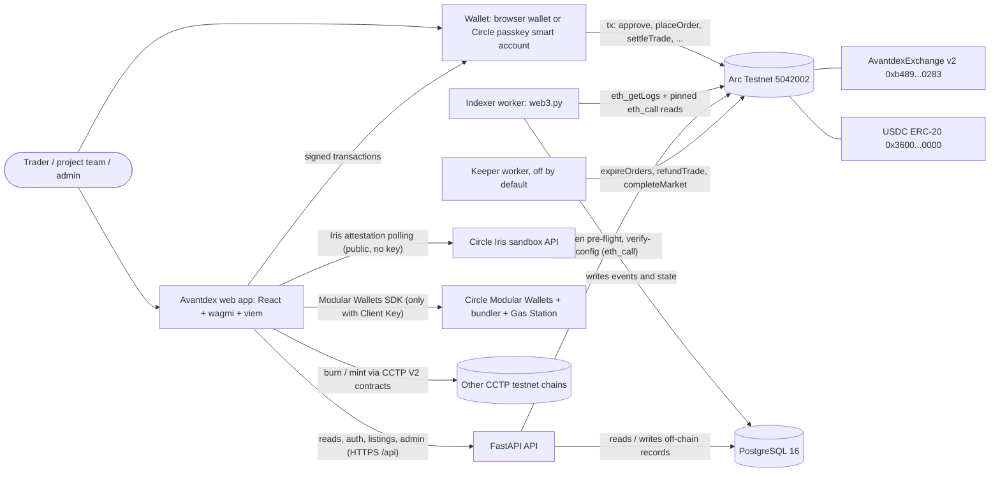
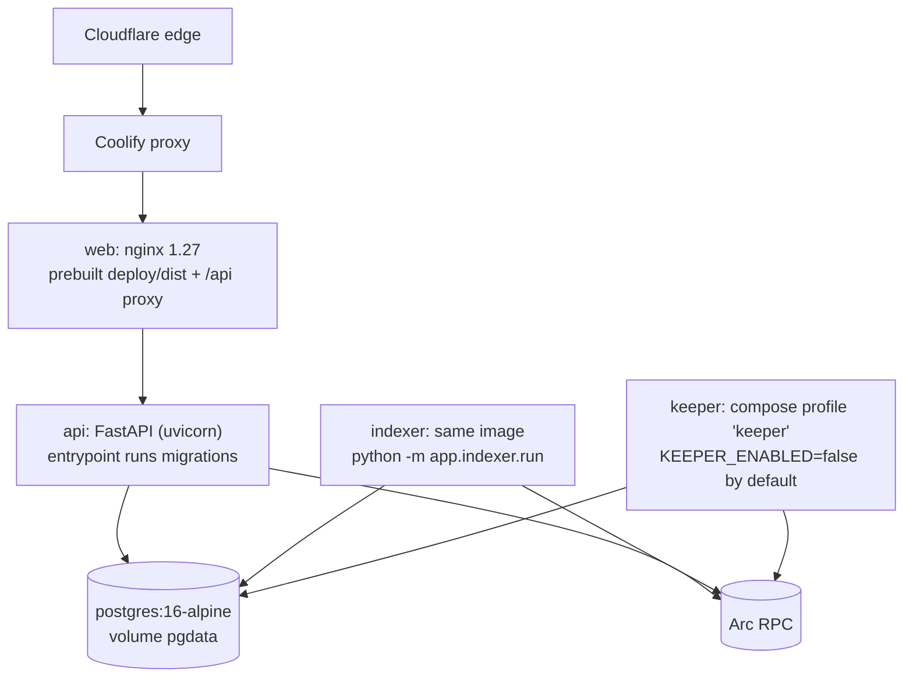
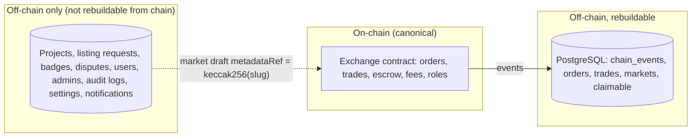
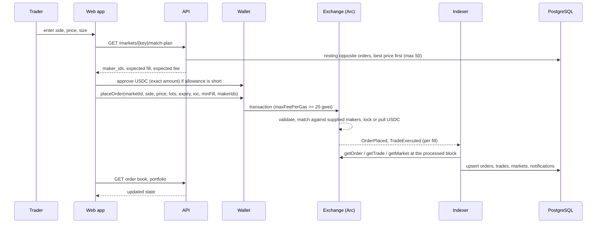

# 02. System architecture

Audit date: 2026-11-21, commit `f6e4da8`. Status labels are defined in `13-evidence-and-information-gaps.md` (VERIFIED, IMPLEMENTED, PARTIAL, PLANNED, MISSING, UNKNOWN).

## 1. One-paragraph summary

Avantdex is a pre-TGE (pre-token-launch) order-book marketplace. Resting orders and all funds live on-chain in one Solidity contract on Arc Testnet; USDC is locked at order placement. A FastAPI backend and a web3.py indexer copy contract events into PostgreSQL so the web app can show order books, portfolios and admin tools quickly. The chain is the source of truth and the database can be rebuilt by replaying events. The React front end talks to the user's wallet for every money action and to the API for reads, listings and admin work. Circle technology appears in four places: USDC as the only settlement currency, CCTP V2 for moving USDC between chains (the Bridge page), Circle Modular Wallets for passkey sign-in (optional, off on the live site until a Client Key is set), and Circle's Iris attestation API.

## 2. Technology stack (versions from the repository)

| Layer | Technology | Version / evidence | Status |
|---|---|---|---|
| Smart contract | Solidity | `pragma solidity 0.8.28`; `foundry.toml`: `solc_version = "0.8.28"`, `evm_version = "cancun"`, optimizer 200 runs | VERIFIED |
| Contract libraries | OpenZeppelin Contracts | `package.json`: `5.6.1` (AccessControl, Pausable, ReentrancyGuard, SafeERC20, IERC20Metadata) | VERIFIED |
| Contract tooling | Foundry | `.foundry-version` `v1.7.1` (Docker image `ghcr.io/foundry-rs/foundry:v1.7.1`) | VERIFIED |
| Backend | Python, FastAPI, SQLAlchemy, Alembic, Pydantic, web3.py, PyJWT | `backend/requirements.txt`: Python 3.12 image, `fastapi==0.115.6`, `SQLAlchemy==2.0.36`, `alembic==1.14.0`, `pydantic==2.10.4`, `web3==7.6.1`, `PyJWT==2.10.1`, `psycopg 3.2.3` | VERIFIED |
| Database | PostgreSQL 16 | `docker-compose.yml`: `postgres:16-alpine`; 3 Alembic migrations; 17 tables in `backend/app/models.py` | VERIFIED |
| Frontend | React 18, Vite 6, TypeScript 7, Tailwind 3, wagmi 2, viem 2.57.5, ConnectKit, TanStack Query, framer-motion, three.js | `package.json` | VERIFIED |
| Circle packages in `package.json` | `@circle-fin/bridge-kit` 1.16.0, `adapter-viem-v2`, `modular-wallets-core`, `app-kit`, `developer-controlled-wallets`, `smart-contract-platform`, `user-controlled-wallets`, `w3s-pw-web-sdk` | Only three are imported by application code (see `06-circle-integration-audit.md`) | VERIFIED |
| Web server | nginx 1.27 (alpine) serves a prebuilt bundle and proxies `/api/` | `Dockerfile`, `nginx.conf` | VERIFIED |
| Hosting | Coolify behind Cloudflare | `docker-compose.yml` header, `docs/RUNBOOK.md`; live response header `Server: cloudflare` | VERIFIED (header) |
| Chain | Arc Testnet, chain id 5042002, RPC `https://rpc.testnet.arc.io`, USDC ERC-20 `0x3600...0000` (6 decimals) | `backend/app/config.py`; live `eth_chainId` returned `0x4cef52` = 5042002 | VERIFIED |
| Runtime config | `/api/config` supplies addresses, fee constants, Circle wallet and CCTP settings to the browser | `backend/app/routers/public.py` line 27; live response read today | VERIFIED |

## 3. System context

## 4. Deployment topology (what runs where)

Evidence: `docker-compose.yml` services `postgres` (line 28), `api` (42), `indexer` (70), `keeper` (85, `profiles: ["keeper"]`), `web` (104); `backend/Dockerfile` (non-root user uid 10001); `Dockerfile` (static image, healthcheck on `/healthz`). The frontend is **built on a developer machine and committed** (`bun run build:static` writes `deploy/dist`); the server never builds. Consequence: what runs in production is whatever bundle was last committed and deployed. The live `index.html` header `last-modified` is Wed, 18 Nov 2026 16:50:45 GMT.

## 5. Component responsibilities

| Component | Responsibility | Key files |
|---|---|---|
| `AvantdexExchange` contract | All money rules: order placement and locks, matching at the maker's price, trade escrow, settlement, default, refund, fees, pause, roles | `contracts/AvantdexExchange.sol` |
| Indexer | Copies the contract's events into `chain_events` (11 event types have handlers; `FeeCollected` and `FeeCollectorUpdated` are stored but otherwise ignored) (idempotent by `(tx_hash, log_index)`), then re-reads touched markets, orders, trades and claimable balances from the contract **pinned to the processed block**; resets itself when `EXCHANGE_ADDRESS` changes | `backend/app/indexer/worker.py` (`run_once` 142, `_process` 190, `_sync` 366, `_reset_for_new_contract` 108) |
| Public API | Config, health, markets, order book, match plan (advisory list of maker order ids, best price first), stats, recent trades, portfolio views | `backend/app/routers/public.py` |
| Auth API | Single-use nonce, signature verification (ECDSA, ERC-1271, ERC-6492), JWT session (12 h; admin 2 h) | `backend/app/routers/auth.py`, `security.py`, `smart_sig.py` |
| User API | Project submission and review state, listing requests (rate limited), notifications, disputes | `backend/app/routers/user.py` |
| Admin API | Project review, market draft, on-chain verification of the draft, approval, delisting (off-chain), token pre-flight, attention list, keeper status, roles, audit logs, settings | `backend/app/routers/admin.py` |
| Ops job | Runs inside the indexer loop every `OPS_INTERVAL_SECONDS` (60 s): deadline reminders, attention list, optional webhook. Sends no transactions. | `backend/app/ops.py` |
| Keeper | Optional chores that need no trust: `expireOrders`, `refundTrade`, optionally `completeMarket`. Simulates before sending; at least 20 gwei fee | `backend/app/keeper.py`, `docs/KEEPER.md` |
| Web app | Wallet connect, order entry (match plan, approval, `placeOrder`), portfolio, listing forms, admin dashboard, bridge, roadmap | `src/` |
| Bridge | CCTP V2 Standard transfer run by our own code (approve, burn, Iris polling, attestation check, `receiveMessage`), or Circle's Forwarding Service through Bridge Kit | `src/pages/Bridge.tsx`, `src/lib/cctp.ts`, `directBridge.ts`, `bridgeRoutes.ts` |

## 6. Source of truth and trust boundaries

* **On-chain facts are canonical.** The indexer stores events and then re-reads state with `call(block_identifier=block)` (`worker.py` lines 369 to 387), so a lagging RPC node cannot write stale state. Status: VERIFIED by reading the code; replay-rebuild is stated in `docs/INDEXER.md` and exercised by `_reset_for_new_contract` (the DB was reset and re-indexed when v2 replaced v1).
* **Off-chain data is editorial.** Project descriptions, badges, "delisted" flags and disputes are not on-chain and not rebuildable from events. A database loss would lose them (no backup policy is documented in the repository; see `07-database-backend-security.md`).
* **Admin power is split.** Off-chain admin (database role row, JWT, one level called super admin) controls what the site shows. On-chain admin (`DEFAULT_ADMIN_ROLE`, `MARKET_MANAGER_ROLE`, `PAUSER_ROLE`) controls market status transitions. Neither can move escrowed funds (see `04-smart-contract-analysis.md`).

## 7. Data flow for a trade (summary; step-by-step in `03-feature-walkthrough.md`)

Design property to note: **matching happens on-chain against maker ids the caller supplies.** The API's match plan is advisory. The contract skips ineligible makers (filled, expired, own, non-crossing, other market) but does **not** enforce best-price or time priority across the order book. See `04-smart-contract-analysis.md`, risk R-7.

## 8. Chain-specific design decisions

| Decision | Where | Why |
|---|---|---|
| USDC only; 6-decimal ERC-20 view only; the native 18-decimal view is never read for money | `AvantdexExchange.sol` (`usdc` immutable, `_pullUsdc`, `_pay`); `src/lib/exchange.ts` | Arc exposes one USDC in two decimal formats; mixing them is a 10^12 error |
| `maxFeePerGas` at least 20 gwei | `src/hooks/useTx.ts` line 31; `backend/app/keeper.py` line 74; `src/lib/directBridge.ts` line 104; scripts | Arc silently drops lower-priced transactions (`docs/AUDIT-2026-11-ARC-CIRCLE.md`) |
| Push-with-fallback payouts to `claimable` | `_pay` (line 685) | USDC on Arc reverts for blocklisted accounts; a blocklisted party must not block others |
| No reorg handling in the indexer | `worker.py` | Arc has deterministic finality per Arc documentation (as recorded in the audit doc) |
| Arc-only listings | `backend/app/utils.py` `arc_chain`; API error `arc_only` | Settlement pulls the project token on Arc, so the token must exist on Arc |

## 9. What the architecture does not have

* No multi-process safe rate limiter (counters are in memory per API process; the nonce, verify, project, listing and dispute limits reset on restart and are not shared across replicas).
* No message queue, cache layer, or read replica. Not needed at current scale; stated for completeness.
* No on-chain price oracle, and none is needed for the current design.
* No upgradeability: the contract has no proxy and no `delegatecall`. A change means a new deployment, which is what happened v0 to v1 to v2 (`deployments/`).
* No continuous integration: there is no `.github/` directory.
