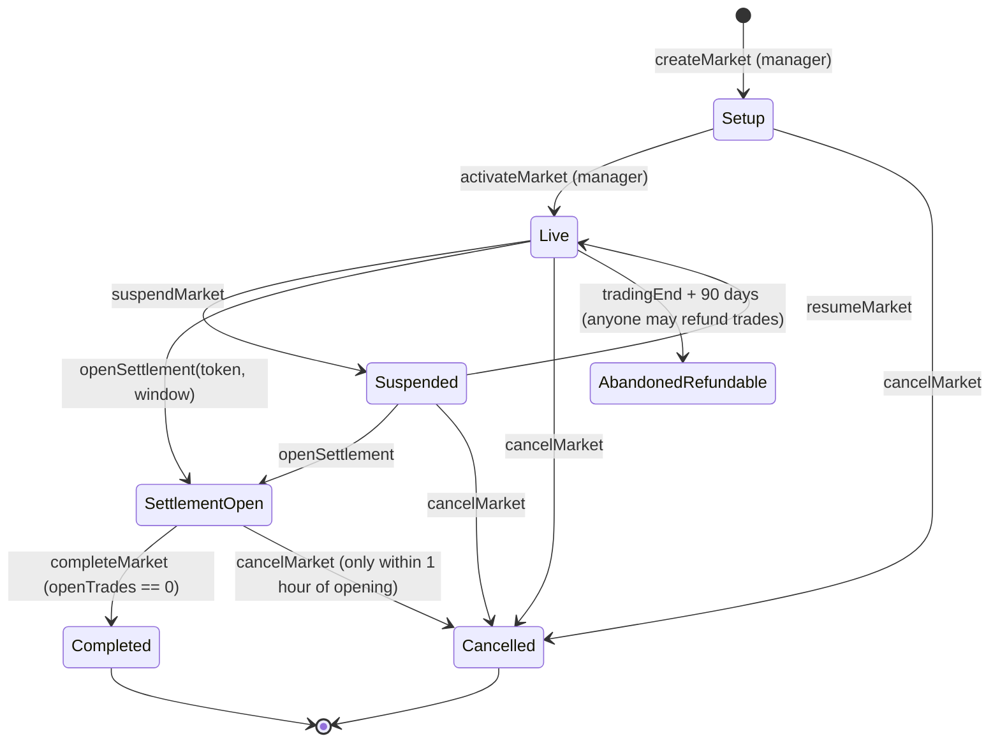
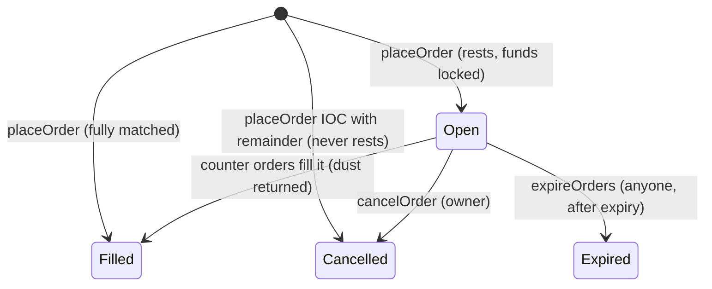
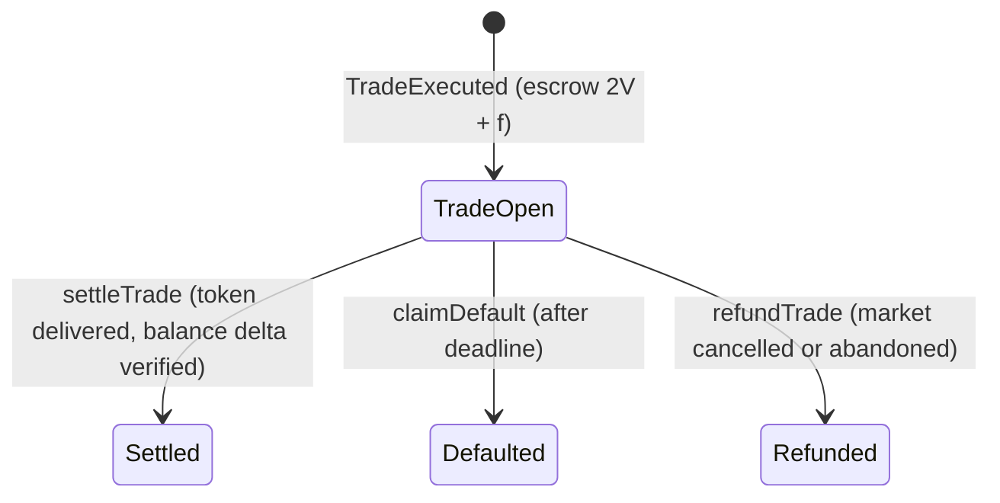
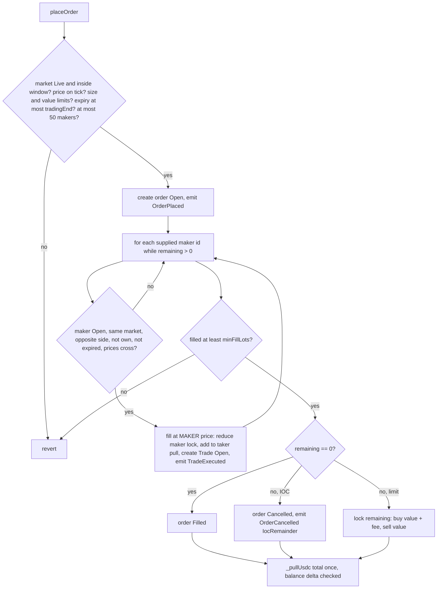

# 04. Smart contract analysis

Audit date: 2026-11-21. Subject: `contracts/AvantdexExchange.sol` (698 lines, read in full), deployed as **v2** on Arc Testnet at `0xb48935EeA3B7264a53098B1DB920C3fCa09C0283` (deploy block 71711143, tx `0x3d493266836bc1ee6cf4e296d007a899cd3e8f15bc7614d0bf9624a663e4ce93`, `deployments/arc-testnet.json`).

> **This is a desk review by the author of this package, not an independent security audit.** The contract is **not audited** (the file header, `deployments/arc-testnet.json` `"audited": false`, `/api/config` `"audited": false`, and every page of the site say so). Nothing below should be presented to Circle or to users as a security assurance. Severity labels are for a hypothetical mainnet launch holding real funds.

## 1. Facts verified today (read-only, Arc Testnet, 2026-11-21)

| Fact | Value read from chain | Result |
|---|---|---|
| Chain id | `0x4cef52` = 5042002 | matches config |
| Runtime code size at the address | 16,175 bytes | matches `AGENTS.md` and `docs/TEST-REPORT.md` (the earlier local-build comparison, only the USDC immutable differing, is recorded there; this audit did not repeat it). Below the 24,576-byte limit |
| `usdc()` | `0x3600000000000000000000000000000000000000` | Arc USDC |
| `feeCollector()` | `0x136a2C17E0E6C077F48F489BeC6DBCE3202CEbd6` | matches repository |
| `BUYER_FEE_BPS`, `SELLER_FEE_BPS` | 50, 50 | 0.5% each |
| `paused()` | false | |
| Admin wallet `0x3788...9baE9` | holds `DEFAULT_ADMIN_ROLE`, `MARKET_MANAGER_ROLE`, `PAUSER_ROLE` | one externally owned address holds all three |
| Testnet deployer wallet `0xd6ac...65dC` | holds no `DEFAULT_ADMIN_ROLE` | consistent with `AGENTS.md` |
| `marketCount`, `orderCount`, `tradeCount` | 4, 15, 4 | |
| Contract USDC balance | 84.449 USDC (testnet) | escrow of open orders and trades |

## 2. Structure

* `contract AvantdexExchange is AccessControl, Pausable, ReentrancyGuard` (OpenZeppelin 5.6.1). `using SafeERC20 for IERC20`.
* One immutable (`usdc`), one mutable address (`feeCollector`), three counters, five mappings (`_markets`, `_orders`, `_trades`, `claimable`, `metadataRefUsed`).
* No proxy, no `delegatecall`, no `selfdestruct`, no `payable` function, no `receive` or `fallback` (native value is rejected; test `test_rejectsNativeValue`). No oracle. No external call except to USDC and to the project token.
* Constants: `BUYER_FEE_BPS = 50`, `SELLER_FEE_BPS = 50`, `BPS = 10_000`, `MIN_TRADING_DURATION = 1 h`, `MIN_SETTLEMENT_WINDOW = 1 h`, `MAX_SETTLEMENT_WINDOW = 14 d`, `MAX_SETTLEMENT_TOTAL = 30 d`, `CANCEL_GRACE = 1 h`, `ABANDON_DELAY = 90 d`, `MIN_ORDER_VALUE = 1_000_000` (1 USDC), `MAX_BATCH = 50`.
* Enums: `MarketStatus {None, Setup, Live, Suspended, SettlementOpen, Completed, Cancelled}`, `Side {Buy, Sell}`, `OrderStatus {None, Open, Filled, Cancelled, Expired}`, `TradeStatus {None, Open, Settled, Defaulted, Refunded}`.
* 14 events, 28 custom errors (lines 145 to 221).

## 3. Function inventory

| Function (line) | Access | Modifiers | What it does | Events |
|---|---|---|---|---|
| `constructor(usdc_, feeCollector_, admin_)` (230) | deploy | | Rejects zero addresses; grants all three roles to `admin_` | `FeeCollectorUpdated` |
| `setFeeCollector(addr)` (243) | `DEFAULT_ADMIN_ROLE` | | Changes where **future** fees are paid; cannot touch escrow | `FeeCollectorUpdated` |
| `pause()` / `unpause()` (250, 254) | `PAUSER_ROLE` | | Toggles `Pausable`; only `placeOrder` is `whenNotPaused` | `Paused` / `Unpaused` |
| `createMarket(token, lotSize, tickSize, minLots, maxLots, tradingStart, tradingEnd, metadataRef, tokenDecimals)` (260) | `MARKET_MANAGER_ROLE` | | Validates parameters; if a token is given it must be a contract with matching `decimals()`; a non-zero `metadataRef` can be used once; status `Setup` | `MarketCreated`, `MarketStatusChanged` |
| `activateMarket(id)` (302) | manager | | `Setup` to `Live` | `MarketStatusChanged` |
| `suspendMarket(id)` / `resumeMarket(id)` (309, 316) | manager | | `Live` to `Suspended` and back. Suspending stops new orders only | `MarketStatusChanged` |
| `cancelMarket(id)` (328) | manager | | To `Cancelled` from `Setup`, `Live`, `Suspended`, or `SettlementOpen` **only within `CANCEL_GRACE` (1 h) of settlement opening**. Makes every open trade refundable | `MarketStatusChanged` |
| `openSettlement(id, token, windowSeconds)` (343) | manager | | From `Live` or `Suspended`; window 1 h to 14 d; token must be a contract, equal to a preset token, with `decimals()` equal to the stored value; stops trading | `SettlementOpened`, `MarketStatusChanged` |
| `extendSettlement(id, newDeadline)` (366) | manager | | Moves the deadline later, never beyond 30 d after opening | `SettlementExtended` |
| `completeMarket(id)` (376) | manager | | `SettlementOpen` to `Completed`, only when `openTrades == 0` | `MarketStatusChanged` |
| `placeOrder(marketId, side, price, lots, expiry, ioc, minFillLots, makerIds[])` (396) | anyone | `whenNotPaused`, `nonReentrant` | Validates; creates the order; matches against supplied maker ids; locks or pulls USDC | `OrderPlaced`, `TradeExecuted`, `OrderCancelled` |
| `cancelOrder(orderId)` (454) | order owner | `nonReentrant` | Returns the remaining lock; always allowed | `OrderCancelled` |
| `expireOrders(ids[])` (462) | anyone | `nonReentrant` | Closes expired open orders (up to 50); refund goes to each owner | `OrderCancelled` |
| `settleTrade(tradeId)` (479) | **anyone** | `nonReentrant` | Delivery and payout (see section 5) | `TradeSettled`, `FeeCollected` |
| `claimDefault(tradeId)` (509) | **anyone** | `nonReentrant` | After the deadline: buyer receives `2 x value + buyerFee` | `TradeDefaulted` |
| `refundTrade(tradeId)` (525) | **anyone** | `nonReentrant` | When refundable: buyer `value + buyerFee`, seller `value` | `TradeRefunded` |
| `withdrawClaimable()` (542) | the credited account | `nonReentrant` | Pays USDC that could not be pushed earlier | `ClaimableWithdrawn` |
| `getMarket`, `getOrder`, `getTrade`, `feeOf`, `isRefundable` (552 to 571) | view | | Reads | |
| Internal: `_match` (601), `_closeOrder` (668), `_pullUsdc` (677), `_pay` (685), `_fee` (581), `_requireDecimals` (586), `_isRefundable` (594), `_market` (575) | | | | |

## 4. Access control and what no role can do

| Capability | Who | Notes |
|---|---|---|
| Move a market through its status machine; open, extend and complete settlement; create markets | `MARKET_MANAGER_ROLE` | Cannot move USDC or tokens. Cannot cancel a market after settlement has been open for one hour |
| Pause or unpause **new orders** | `PAUSER_ROLE` | Cancel, expire, settle, default, refund and withdraw stay open when paused |
| Change the fee collector; grant and revoke every role (OpenZeppelin `AccessControl`) | `DEFAULT_ADMIN_ROLE` | Can redirect **future fee income** to another address. Cannot redirect escrow. Can grant itself any role |
| Settle, claim a default, refund, expire | anyone | Payouts always go to the rightful party; the token for settlement is pulled from the seller's own balance and allowance |
| **No function exists** that lets any role withdraw escrowed USDC, change a trade, change an order, or change a fee rate | none | Fee rates are `constant`. Test `test_adminCannotTouchEscrow_noRoleCanWithdraw` and invariant `invariant_solvency` back this up |

Centralisation point (see R-2): the live deployment has **one EOA** holding all three roles. There is no multisig, timelock or two-person control on chain. The dashboard has an optional two-person approval for market activation (`REQUIRE_TWO_PERSON_APPROVAL`, off by default) but it is an off-chain gate.

## 5. Escrow and fund flows

Notation: `V = price x lots` (USDC base units, 6 decimals), `f = floor(V x 50 / 10000)` (the same on both sides).

| Event | Buyer pays or locks | Seller locks | Where the funds sit |
|---|---|---|---|
| Resting buy order for `n` lots at price `p` | `n x p + f(n x p)` | | Contract (order lock) |
| Resting sell order | | `n x p` (collateral, 100% of value) | Contract (order lock) |
| A fill of `V` | taker or maker pays `V + f` | `V` | Contract (trade escrow: `2V + f`) |
| **Settled** (`settleTrade`) | receives the tokens | receives `2V - f` | Seller gets payment plus own collateral minus seller fee; collector gets `2f` |
| **Defaulted** (`claimDefault`) | receives `2V + f` | loses collateral | Buyer gets own payment, fee reserve and the seller's collateral; **no fee** |
| **Refunded** (`refundTrade`) | receives `V + f` | receives `V` | **no fee** |
| Cancelled or expired order | receives the remaining lock | receives the remaining lock | **no fee** |

Conservation check (written out, matching `invariant_solvency` and `testFuzz_partialFillsKeepSolvency`): into the trade escrow `V + f` (buyer) plus `V` (seller) is `2V + f`. Settled out: `(2V - f) + 2f = 2V + f`. Defaulted out: `2V + f`. Refunded out: `(V + f) + V = 2V + f`. Each path pays out exactly what came in.

Payout mechanics: `_pay` (line 685) tries `usdc.transfer`; if the call fails or returns false it credits `claimable[to]` and emits `ClaimableCredited`; the account later calls `withdrawClaimable`. This is how a blocklisted recipient (USDC on Arc reverts for them) cannot block anyone else. Pulls use `_pullUsdc` (line 677): balance before and after must differ by exactly the amount (`PullShortfall`). Token delivery in `settleTrade` is balance-delta verified on the **buyer** (`DeliveryNotVerified`), which defeats fee-on-transfer and rebasing tokens by reverting the whole call.

## 6. Order, trade and market lifecycles







### 6.1 Market creation

```mermaid
sequenceDiagram
  participant Adm as Admin (browser)
  participant API as Backend
  participant C as Exchange
  participant I as Indexer
  Adm->>API: POST /admin/markets (draft; metadataRef = keccak256(slug))
  Adm->>C: createMarket(...) as MARKET_MANAGER
  C->>C: checks params, decimals if token known, metadataRef unused
  C-->>I: MarketCreated, MarketStatusChanged(Setup)
  I->>API: link draft by metadataRef, store onchain_id
  Adm->>API: GET verify-config (reads chain, 9 fields)
  Adm->>C: activateMarket(id)
  C-->>I: MarketStatusChanged(Live)
```

### 6.2 Order placement and matching (inside `placeOrder`)



### 6.3 Cancellation, refund and settlement

Cancel and expire: `_closeOrder` returns `locked` through `_pay` (line 668). Refund and settlement sequences are drawn at the end of `03-feature-walkthrough.md` ("Pipeline map for the three money flows").

## 7. Fee analysis

* 0.5% buyer plus 0.5% seller of trade value, **charged only when a trade settles**; paid in USDC to `feeCollector` in one transfer (`2f`). No fee on order cancel, expiry, default, refund, listing, or failed transactions (tests `testFuzz_settledTradeFeesExact`, `testFuzz_failurePathsNeverChargeFee`, invariant `invariant_collectorOnlyGetsSettledFees`).
* Rates are `constant`; only the collector address is changeable (by `DEFAULT_ADMIN_ROLE`).
* Rounding: `_fee` floors. The buyer's lock for the unfilled rest uses the fee on the remaining value; per-fill floors never exceed it, and rounding dust is returned when an order fills completely (`test_roundingDustReturnedWhenMakerFullyFilled`). A fill whose value is below 200 base units pays a zero fee; the 1 USDC minimum applies to the order, not to each fill.
* Revenue evidence on Arc Testnet: one settled trade, fees 0.06 + 0.06 = 0.12 USDC (API `fees_paid` 120000, chain trade 2). Testnet, not revenue.

## 8. Pause behaviour

`pause()` blocks `placeOrder` only. `cancelOrder`, `expireOrders`, `settleTrade`, `claimDefault`, `refundTrade`, `withdrawClaimable` and all manager functions stay callable (test `test_pause_blocksNewOrdersOnly`, `test_cancelAlwaysAllowed_whenPausedSuspendedOrCancelled`). An emergency stop therefore cannot trap users, and also cannot stop a bad settlement in progress.

## 9. Risk register (desk review; mainnet severity)

| ID | Severity | Risk | Evidence | Mitigation present | Gap or recommendation |
|---|---|---|---|---|---|
| R-1 | **High** | **Settlement token set by one manager signature.** If the market was created without a token (the normal pre-TGE case), `openSettlement` accepts any contract with matching `decimals()`. A manager who is also a buyer could name a token sellers do not hold; nobody can deliver; after the deadline `claimDefault` pays the buyer payment plus the seller's collateral | `openSettlement` lines 343 to 363; `docs/AUDIT-2026-11-ARC-CIRCLE.md` H-1 | Dashboard token pre-flight (advisory); `CANCEL_GRACE` lets a manager undo a **mistake**, not abuse; token fixed at creation if known | Two-step `proposeSettlementToken` with a public delay, a project-team-signed token address, a multisig plus timelock for `MARKET_MANAGER`. **Mainnet blocker** per the repository's own audit |
| R-2 | **High** | **Single-EOA control.** One wallet holds `DEFAULT_ADMIN`, `MARKET_MANAGER` and `PAUSER` (read on chain today). Key loss or compromise enables R-1, fee redirection, role grants, and denial of new markets | on-chain `hasRole` reads | No role can move escrow | Multisig plus timelock before mainnet; separate roles; documented key custody (UNKNOWN today) |
| R-3 | Medium | **Economic bound of seller collateral.** Collateral equals trade value, so a default pays the buyer `2V + f`. A rational seller defaults when the token's value exceeds `2V` (twice the agreed price): their tokens are then worth more than payment plus collateral. Buyers are protected only up to a 2x move | arithmetic from section 5 (`settleTrade` vs `claimDefault`) | Window extension, reminders | State this on the market page and in risk copy; consider higher collateral for volatile tokens or margin top-up (needs design and tests) |
| R-4 | Medium | **Token behaviour.** Fee-on-transfer, rebasing, hook (ERC-777 style), pausable or blocklisting tokens can make a willing seller unable to settle (forced default) | `settleTrade` delta check; `docs/SETTLEMENT-AUDIT-AND-PLAN.md` M5, L-5 | Delta check reverts atomically (`test_settleTrade_feeOnTransferTokenRevertsAtomically`); manager review | Add behavioural pre-flight and a token-risk note per market |
| R-5 | Medium | **Liveness depends on the manager.** If settlement is never opened and the market is not cancelled, open trades stay locked until `tradingEnd + 90 days` (`ABANDON_DELAY`); orders can always be cancelled | `_isRefundable` line 594 | 90-day abandonment refund; permissionless `refundTrade` | Shorter or configurable abandonment delay; keeper alerts |
| R-6 | Medium | **Issuer dependency.** Circle can blocklist any address, including the exchange contract, or pause USDC; all escrow depends on it | `docs/AUDIT-2026-11-ARC-CIRCLE.md` L-7 | Push-with-fallback protects against a blocklisted **recipient**, not a blocklisted contract | Disclose in risk copy; inherent to a USDC-only design |
| R-7 | Medium | **No on-chain price-time priority.** The taker chooses the maker ids; the contract fills them in the supplied order if they cross. A caller can skip better-priced makers, or trade with an affiliated wallet (self-trade is blocked only for the same address). The API match plan is advisory | `placeOrder` loop line 429; `_match` line 601; `public.py` `match_plan` | Maker-price execution protects the taker's limit; `minFillLots` slippage guard | Do not describe the book as price-time priority; wash-trading controls and volume definitions matter for reporting traction |
| R-8 | Medium | **No upgrade path.** No proxy by design; a defect means a new deployment, and open positions do not migrate (the indexer reset when v2 replaced v1) | `deployments/` v0, v1, v2 | Small, bounded contract | A migration or wind-down procedure before mainnet |
| R-9 | Low | **`_pay` treats an empty return from a non-contract as success.** Only relevant if `usdc` were an address without code; the constructor does not check. The deployed `usdc` is the real Arc USDC (read today) | `_pay` lines 685 to 697; constructor line 230 | Immutable, correct on the live deployment | Add a code-size and `decimals() == 6` check in the constructor of any future version |
| R-10 | Low | **Fee collector change** redirects future fees | `setFeeCollector` line 243 | Admin only; event emitted | Multisig (R-2) |
| R-11 | Low | **Funds sent directly to the contract** (plain ERC-20 transfer) are unrecoverable; accounting is unaffected because every pull uses a delta | repository audit L-6 | Delta checks | UI copy |
| R-12 | Low | **Arc behaviour not tested on Arc tooling.** Forge runs on a standard EVM (`cancun`) with a mock USDC; Arc's native and ERC-20 duality, blocklist enforcement and system logs are not reproduced | repository audit M-2; `foundry.toml` | Mock blocklist USDC tests | CI job with Arc Foundry; run revert paths with Arc's published blocklisted test address |
| R-13 | Low | **Timestamps.** Arc timestamps are non-decreasing, not strictly increasing. The contract only compares against stored times with `<`, `<=`, `>`, `>=` | `placeOrder`, `claimDefault`, `cancelMarket` | Yes | None |

What was checked and found sound (by reading, not by formal proof): `nonReentrant` on every state-changing user path; checks-effects-interactions in `settleTrade`, `claimDefault`, `refundTrade` (status and counter updated before external calls); bounded loops (50); overflow guards when narrowing to `uint128`; no `msg.value` use; no role can reach escrow.

## 10. Test evidence for the contract (counted statically, not re-run)

* `contracts/test/Avantdex.t.sol`: **64 test functions** (61 unit tests and 3 fuzz tests: `testFuzz_settledTradeFeesExact`, `testFuzz_failurePathsNeverChargeFee`, `testFuzz_partialFillsKeepSolvency`) plus **2 invariants** (`invariant_solvency`, `invariant_collectorOnlyGetsSettledFees`) with a handler contract. Coverage by name: roles and constructor, market status machine, placement validation, window and approvals, maker-price execution with partial fills, multi-maker, skipped makers, IOC rules, cancel and expiry, rounding dust, settlement validation, atomic swap and fees, fee-on-transfer revert, default, extension, completion, cancel grace window (v2), decimals (v2), metadata reuse (v2), stranger settle (v2), abandonment, pause, five blocklist cases, native value rejection, admin cannot touch escrow, fee-collector change.
* `contracts/test/AllocX.t.sol`: 46 tests for the **legacy** contracts. The repository's "112 passed" for `forge test` equals 64 + 2 + 46. The v2 contract is therefore covered by **66** of the 112.
* Not present: formal verification, a differential test against a reference model, a mutation test, a published coverage report, an independent audit.
