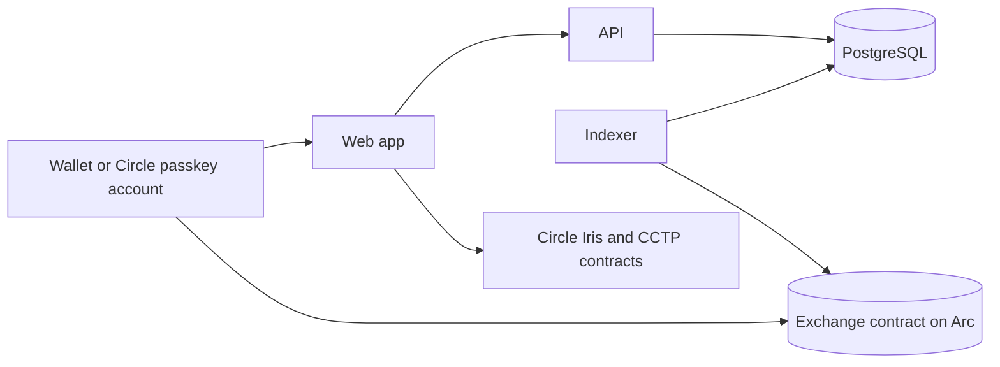

# 10. Circle Developer Grant proposal (draft for the founders)

Prepared 2026-11-21 from the repository audit in this folder. **This is a draft application written in the applicant's voice.** Every factual statement is backed by a file, a live read or a recorded test cited in documents 01 to 09. Items in `[FOUNDER INPUT: ...]` brackets are things the repository cannot supply and must not be filled with guesses. All amounts are **proposals**, not quotes. Program facts come from `https://www.circle.com/grant` (read 2026-11-21): milestone-based USDC funding of $10,000 to $100,000, most grants between $10,000 and $20,000, $25,000 or more requiring demonstrated traction and wider scope; applications are judged on platform alignment, team, traction or credible path, and ecosystem impact; the minimum bar is a working product, a technical roadmap showing the role of Circle products and Arc, and at least one Circle integration demonstrable on video.

---

## A. Executive summary

**Avantdex is a pre-TGE order-book marketplace on Arc where USDC is the only money.** Traders buy and sell tokens that have not launched yet. Funds are locked on-chain when an order is placed; each trade escrows the buyer's payment and the seller's collateral; after the token launches the seller delivers atomically (token for USDC in one transaction, delivery verified by balance change) or the buyer claims payment plus the seller's collateral. Platform fees are 0.5% per side, in USDC, and only on settled trades.

**Where we are.** A working testnet product: the v2 contract is deployed on Arc Testnet (`0xb489...0283`), a web app, API, indexer and admin dashboard are live at `https://avantdex.xyz`, with settlement and refund executed on chain. The contract has 66 tests for the shipping version (unit, fuzz, invariants) and the backend 88. We have **not** been audited and we are **not** on mainnet; the site says so on every page.

**Circle and Arc in the product.** USDC is the sole settlement asset; Arc is the settlement layer and listings are restricted to tokens that exist on Arc; a CCTP V2 bridge lets users fund Arc from other networks (testnet); Circle Modular Wallets passkey sign-in is built, tested with local accounts, and ready to switch on with a Client Key.

**The ask.** A milestone-based grant of **$20,000 to $25,000 USDC** (Production-ready scenario, section J) to put the Circle integrations into running testnet production, close the one design blocker our own audit found (settlement token selection), fund an independent audit, and prepare a controlled mainnet beta on Arc. The upper end applies only if the traction evidence in section G is stronger at submission time than it is today. A leaner $10,000 scenario is available.

**What we are not claiming:** no audit, no mainnet, no real users or volume (all activity is testnet), no Circle product in production today.

## B. Problem

Before a token launches, price discovery happens in private chats and spreadsheets with no enforceable settlement; sellers can promise tokens and disappear, buyers can refuse to pay; users cannot see who controls funds or what happens if a launch is delayed or cancelled; and anyone can claim a token will exist (`R&D.md` section 4). Existing pre-market platforms exist (one was researched by the project from its public documentation on 2026-11-03: Whales Market); they typically rely on seller-posted proof of delivery. `[FOUNDER INPUT: first-party evidence of demand: interviews, waitlist, project requests, Arc ecosystem conversations. The repository contains none and the project deliberately did not estimate market size.]`

## C. Solution

| Element | How it works | Evidence |
|---|---|---|
| Collateralised escrow | A fill escrows buyer payment plus a 0.5% fee reserve and seller collateral equal to the trade value | `contracts/AvantdexExchange.sol` `placeOrder`, `_match` |
| Atomic settlement | `settleTrade` moves the token seller to buyer, checks the buyer's balance delta, pays the seller `2 x value - fee`, pays fees | same, line 479 |
| Default protection | After the deadline `claimDefault` pays the buyer payment plus the seller's collateral; callable by anyone | line 509 |
| Cancel and refund paths | Orders cancel any time; a cancelled or abandoned market refunds both sides with no fee | lines 454, 525, 594 |
| No custody by admins | No function lets any role withdraw or redirect escrow; pause stops new orders only | `test_adminCannotTouchEscrow_noRoleCanWithdraw`, `invariant_solvency` |
| Blocklist-safe payouts | Failed USDC pushes become claimable balances | `_pay`, line 685 |
| Listing discipline | Approval, verification and activation are separate steps; token pre-flight; Arc-only rule | `backend/app/routers/admin.py`, `utils.py` |
| Rebuildable data layer | Chain is canonical; indexer replays events and re-reads state at the processed block | `backend/app/indexer/worker.py` |

Known limits we disclose: the seller collateral equals the trade value, so buyer protection holds only up to a 2x move in the token's value; matching is on-chain against maker ids supplied by the caller and does not enforce price-time priority; the settlement token address is set by a manager signature (our own audit's H-1, a mainnet blocker we propose to fix in this grant).

## D. Technical architecture

React 18 and wagmi front end; FastAPI and PostgreSQL 16 back end; a web3.py indexer; one Solidity 0.8.28 contract (OpenZeppelin 5.6.1); Docker Compose on Coolify behind Cloudflare. The browser signs every money action; the API never holds funds or keys. Diagrams and component responsibilities are in `02-system-architecture.md`; the contract's functions, roles, escrow arithmetic and risk register are in `04-smart-contract-analysis.md`.

## E. Circle and Arc alignment

Circle's page asks that Arc is core to the flow of value or settlement and that Circle products are meaningful building blocks. Our position, stated precisely:

| Circle / Arc element | Today | What this grant changes |
|---|---|---|
| Arc | Contract deployed on Arc Testnet; Arc is the settlement layer; Arc-only listings; 20 gwei fee floor, blocklist-safe payouts, USDC 6-decimal handling | Mainnet deployment after the audit (milestone M5) |
| USDC | Sole currency of escrow, collateral, fees, payouts and gas | Unchanged |
| CCTP V2 | Bridge page: own Standard flow (approve, burn, Iris polling, attestation check, mint) and Circle's Forwarding Service through Bridge Kit; 24 testnet networks; verified against real contracts on forks; **a complete public-testnet transfer is not yet recorded** | Record real transfers in both directions; "fund and trade" flow (M1) |
| Circle Modular Wallets | Passkey smart account sign-in and an EIP-1193 provider built and tested with fakes and local accounts; **disabled on the live site** until a Client Key is set | Switch on with a testnet Client Key and Passkey Domain; one-confirmation first trade by batching approval and order (M1) |
| Circle Gas Station | Sponsorship request coded with fallback to the wallet's own USDC; no policy yet | Create a policy; film a first trade with zero gas (M1) |
| Developer-controlled wallets | Package in the project, used only by legacy scripts | Keeper and fee-collector key custody (optional, section I) |
| Gateway, Nanopayments, StableFX, EURC | Not present | Evaluated as expansion options only (section I) |

Honest summary: **no Circle product is in production today.** The first milestone exists to change that on testnet. Document `06-circle-integration-audit.md` lists every Circle package in `package.json` and which are used; unused ones will be removed or integrated before review.

## F. Competitive differentiation

Grounded in the repository's own comparison with one researched competitor (`R&D.md` 6.1, to be re-verified before submission): atomic delivery versus payment rather than seller-posted proof; fees charged only on settled trades; no administrative path to escrow, with every exit open when paused; Arc-native handling of USDC blocklisting, 6-decimal USDC and the fee floor; and a data layer that can be rebuilt from the chain. We do not claim superior liquidity, users or volume. `[FOUNDER INPUT: any additional competitors researched from primary sources, with dates.]`

## G. Traction and evidence

| Evidence | Value | Where to verify |
|---|---|---|
| Live deployment | `https://avantdex.xyz`; indexer lag 0 | `/api/health` |
| Contract on Arc Testnet | v2, 4 markets, 15 orders, 4 trades (1 Settled, 1 Refunded, 2 Open) | read-only chain reads; `deployments/arc-testnet.json` |
| Testnet fees | 0.12 USDC from one settled trade | `/api/stats` (test USDC, not revenue) |
| Tests | forge 66 (v2) plus 46 (legacy), pytest 88, UI test 33 steps, CCTP fork test 11 | `docs/TEST-REPORT.md`, test files |
| Development velocity | 34 commits from 2026-11-01 to 2026-11-18 | `git log` |
| Roadmap progress | Steps 01 and 02 completed 15 and 17 November 2026 | `src/lib/roadmap.ts` |

All activity is **testnet activity by a small number of wallets (4 distinct addresses in 4 trades)**. We present it as proof that the mechanism works end to end, not as users or volume. `[FOUNDER INPUT: pilots, letters of intent, ecosystem partners, community metrics, anything verifiable. If none exists, say so and rely on the milestones.]`

## H. Business model

Fees of 0.5% buyer plus 0.5% seller of trade value, paid in USDC to a fixed collector, **only on settled trades**; listing, cancellation, defaults and refunds are free (`AvantdexExchange.sol` constants; `README.md`). At 1% of settled value, 100,000 USDC of settled trades yields 1,000 USDC (arithmetic, not a forecast). Revenue arrives only after token launches. `[FOUNDER INPUT: monthly running cost, break-even settled volume, and the plan for financial independence from grants, which Circle explicitly weighs.]` Details and risks in `09-product-business-analysis.md`.

## I. Roadmap

The public roadmap (`src/lib/roadmap.ts`) has seven steps, two complete: core platform and testnet validation (15 November 2026); core contract implementation and testing (17 November 2026). Upcoming targets, which can move: security hardening and independent audit (28 February 2027); Arc mainnet deployment (31 March 2027); controlled beta (15 April 2027); public beta (30 April 2027); expansion (30 September 2027 and ongoing).

**Next 3 months (to about 21 February 2027):** switch on and record the Circle integrations; fix the website and API security findings (headers, CSP, scaffold instrumentation, backups, CI, license); design and implement contract v3 (two-step settlement-token proposal with a public delay, multisig and timelock for manager and admin roles, constructor checks, Arc Foundry tests); freeze the audit scope; engage an auditor; recruit pilot projects. **Next 6 months (to about 21 May 2027):** complete the audit and fixes; owner deploys to Arc mainnet with a multisig; controlled beta; public beta targets (100 wallets, 10 listings, 25 trades, stated as goals).

Expansion options, not committed: Gateway or CCTP-hook deposits into escrow (requires a contract version with a deposit balance), EURC-priced markets, an agent-facing paid data API, developer-controlled wallets for keeper key custody. Full plan, effort estimates and dependencies: `11-roadmap-milestones-budget.md`.

## J. Funding request (three scenarios, all proposals)

| Scenario | Amount (USDC) | Scope | Conditions |
|---|---|---|---|
| **A. Lean MVP** | **$10,000** | Circle integrations in running testnet production (passkey wallet, Gas Station, real CCTP transfers, batched first trade), website and API hardening, CI and backups, demo material | None beyond Circle's minimum bar |
| **B. Production-ready (recommended)** | **$20,000 to $25,000** | A plus contract v3 (settlement-token safeguard, multisig and timelock), Arc Foundry tests, independent audit co-funding, mainnet deployment support and a controlled beta | Upper end only if traction evidence improves before submission (Circle: $25,000 or more needs demonstrated traction) |
| **C. Ecosystem expansion** | **$50,000 to $100,000** | B plus deposit-balance contract (Gateway or CCTP hook funding), EURC or StableFX markets, market-maker and listing programs, second audit scope, data API | **Apply only after** external users, pilots and mainnet activity exist; not supportable by today's evidence |

Line items, assumptions and what the founders must replace with quotes are in `11-roadmap-milestones-budget.md`. `[FOUNDER INPUT: audit firm quote, engineering rates, infrastructure costs, legal budget.]`

## K. Milestones and acceptance criteria (Scenario B; A is M1 and M2 only)

| # | Milestone | Acceptance criteria (verifiable by Circle) | Target |
|---|---|---|---|
| M1 | Circle integrations running on testnet | `/api/config` shows `circle_wallet.enabled: true`; a new passkey wallet signs in, places and cancels an order (video); a Gas Station policy sponsors a first trade with zero wallet gas (video); one real CCTP transfer each way with transaction hashes; approval and order batched into one passkey confirmation | about 3 weeks after award |
| M2 | Security and delivery hardening | Live response headers include CSP, HSTS, frame protection and referrer policy (`curl -I` output); tracing scaffold absent from the bundle; CI running `forge test`, `pytest`, typecheck, lint and secret scanning on every push; nightly database backup with a documented restore test; LICENSE present; unused packages removed | about 4 weeks |
| M3 | Contract v3 and audit freeze | Public design note for the settlement-token safeguard; tests for it (positive, negative, fuzz); admin and manager roles held by a multisig with a timelock on a testnet deployment; Arc Foundry suite green including a run against Arc's published blocklisted address; scope freeze tagged in git | about 8 to 10 weeks |
| M4 | Independent audit | Engagement letter with a named firm; final report published; all critical and high findings fixed and re-reviewed | about 12 to 14 weeks (auditor availability UNKNOWN) |
| M5 | Mainnet deployment and controlled beta | Contract deployed from the owner's wallet to Arc mainnet with a multisig; verified source; `/api/config` on mainnet chain id; at least `[FOUNDER INPUT: N]` pilot projects listed; first settled mainnet trade with transaction hash | after M4 |

Disbursement is per milestone as Circle's process describes ("payments are released as milestones are met and approved"). Proposed split for Scenario B: 20% on M1, 15% on M2, 30% on M3, 20% on M4, 15% on M5; for Scenario A: 60% on M1, 40% on M2.

## L. Team (verifiable information only)

| Item | What the repository and public records show |
|---|---|
| Product and domain | Avantdex, `https://avantdex.xyz`, X account `@AvantDex` (named in `README.md`) |
| Repositories | Private `yaminyann/Allox-by-arc`; public `Naim102/avantdex.xyz`. Both `main` branches were at commit `f6e4da8` on 2026-11-18 |
| Commit history | 34 commits, 2026-11-01 to 2026-11-18: 33 by the git author `yaminyann`, 1 by the git author `Naim Hasan` (2026-11-12, "testnet feature are working") |
| Names, roles, prior work, location, legal entity | **Not in the repository.** `[FOUNDER INPUT: each team member's name, role, relevant shipped work with links, time commitment, and the legal entity and jurisdiction.]` |
| Technical ownership | `[FOUNDER INPUT]` The code was produced with AI coding assistance (Claude Code sessions; scaffold markers from Arc Studio in `src/tracing.ts`). State accurately who designed, reviewed and operates it and who holds the deployment keys. Circle asks for "clear technical ownership"; accuracy matters more than polish |
| Key custody | On-chain admin, manager and pauser roles are held by one wallet (`0x3788...9baE9`, read on chain). `[FOUNDER INPUT: who controls it and how it is secured.]` |
