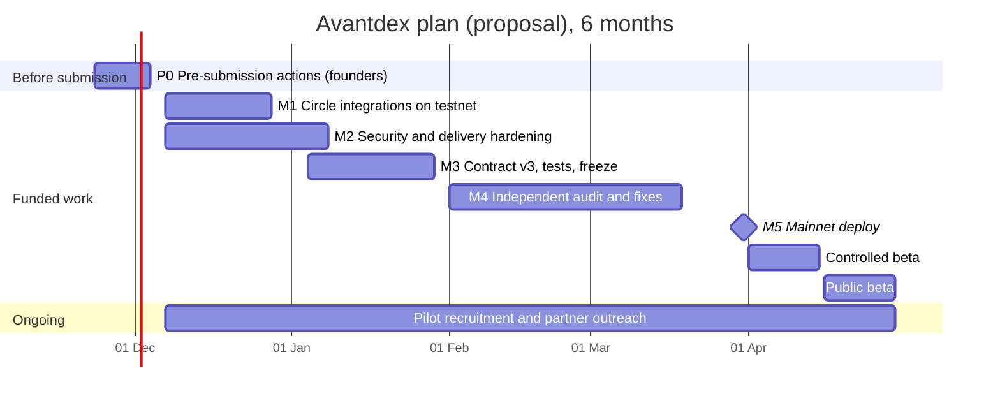

# 11. Roadmap, milestones and budget scenarios

Prepared 2026-11-21. **Everything here is a proposal for the founders to confirm.** Dollar amounts are allocations of a requested grant, not quotes; effort figures are estimates derived from the existing code base (`06-circle-integration-audit.md`, `07-database-backend-security.md`). Items marked `[FOUNDER INPUT]` need real data. Circle's program page (read 2026-11-21) says grants run $10,000 to $100,000 USDC, most between $10,000 and $20,000, and amounts of $25,000 or more need demonstrated traction and a wider scope.

## 1. Fixed points

| Fact | Source |
|---|---|
| Today is 2026-11-21. The contract is v2 on Arc Testnet, not audited | `deployments/arc-testnet.json` |
| The published roadmap targets: audit 28 Feb 2027, Arc mainnet 31 Mar 2027, controlled beta 15 Apr 2027, public beta 30 Apr 2027, expansion 30 Sep 2027 and ongoing | `src/lib/roadmap.ts` |
| Repository rule: mainnet only after an audit; the owner deploys with their own wallet | `AGENTS.md`, `docs/RUNBOOK.md` |
| Mainnet blocker named by the project's own audit: H-1 (settlement token chosen by one manager signature) | `docs/AUDIT-2026-11-ARC-CIRCLE.md` |

## 2. Dependency chain and an honest schedule check

The critical path is: fix H-1 in a new contract version, freeze scope, audit, fix findings, deploy to mainnet. The published dates leave 14 weeks between today and the audit target. An auditor slot, the v3 implementation (about 4 weeks) and the audit itself (typically several weeks; **auditor availability and duration are UNKNOWN until quotes arrive**) do not all fit before 28 February unless an auditor is booked in December. This plan therefore proposes:

* **Plan A (keeps mainnet at 31 March 2027):** freeze v3 by 29 January 2027, audit 1 February to about 5 March, fixes and re-review to about 19 March, mainnet 31 March **only if the audit is clean**. The "audit complete" date moves from 28 February to mid-March.
* **Fallback:** if no auditor can start in early February, every later date slips by the same delay. The project's own rule is to **never go to mainnet unaudited**.

## 3. Three-month plan (21 November 2026 to about 21 February 2027)

| Window | Work | Source of the work item |
|---|---|---|
| Weeks 1 to 2 (23 Nov to 4 Dec) | **P0, founders, no funding needed:** enable Circle Wallet with a testnet Client Key; record one real CCTP transfer each way; create a Gas Station policy; fix nginx header inheritance; remove tracing scaffold from the production bundle; add LICENSE and a CI workflow; remove unused Circle packages; assemble team, entity and cost information; record the demo | `06` steps 0a to 0c; `07` F-1, F-2, F-5, F-7; `00` section 6 |
| Weeks 3 to 6 | **M1 and M2:** batched approve plus order for passkey users; "fund and trade" flow; CSP and HSTS; database backups with a restore test; secret and dependency scanning | `06` steps 1a, 1b; `07` F-3, F-4 |
| Weeks 6 to 10 | **M3:** contract v3: two-step settlement-token proposal with a public delay; multisig plus timelock for manager and admin; constructor checks (USDC has code and 6 decimals); Arc Foundry suite, including a run against Arc's published blocklisted address; keeper `claimDefault` duty; tests and invariants updated | `04` R-1, R-2, R-9, R-12; repository audit M-2, M-5 |
| Weeks 8 to 12 | Engage and brief the auditor; pilot projects recruited (target count `[FOUNDER INPUT]`) | |

## 4. Six-month plan (to about 21 May 2027)

| Window | Work |
|---|---|
| Feb to mid-Mar 2027 | **M4:** audit, fixes, re-review, public report |
| Late Mar 2027 | **M5:** mainnet configuration (the frontend is pinned to Arc Testnet today: repository audit M-6), owner deploys the audited contract with a multisig, verified source, monitoring and backups live, legal terms in place `[FOUNDER INPUT: counsel]` |
| 1 to 15 Apr 2027 | Controlled beta with the pilot projects |
| 16 to 30 Apr 2027 | Public beta; the public goals are 100 wallets, 10 listings, 25 trades (goals, not forecasts) |
| May 2027 | Report to Circle; decide on expansion options (section 7) only against measured traction |

## 5. Work packages

| WP | Title | Effort (person-days, estimate) | Depends on | Delivers |
|---|---|---|---|---|
| WP1 | Circle Wallet live on testnet (Client Key, Passkey Domain, 5-step acceptance checklist) | 0.5 to 1 | Circle Console access | `circle_wallet.enabled: true`, video |
| WP2 | Gas Station policy and zero-gas first trade | 0.5 | WP1 | video |
| WP3 | Real public-testnet CCTP transfers, both directions | 0.5 | testnet funds | transaction hashes, video |
| WP4 | Batched approve plus `placeOrder` for smart accounts | 2 to 4 | WP1 | one passkey confirmation per first trade |
| WP5 | "Fund and trade" flow | 3 to 5 | WP3 | bridge to order form without losing context |
| WP6 | Hardening: nginx headers, CSP, HSTS, remove scaffold tracing, session storage review | 2 to 3 | none | `curl -I` evidence, bundle check |
| WP7 | Delivery hygiene: CI, secret and dependency scanning, backups with restore test, LICENSE, archive legacy code, remove unused packages | 3 to 4 | none | green CI, restore log |
| WP8 | Contract v3 and tests (settlement-token safeguard, multisig and timelock integration, constructor checks), keeper `claimDefault` | 12 to 18 | WP7 | tagged freeze, test report |
| WP9 | Arc Foundry job and real-blocklist test run | 2 to 3 | WP8 | CI job and report |
| WP10 | Independent audit (external) and fix cycle | 5 to 10 (our side) | WP8, WP9, quote | public report, fixes |
| WP11 | Mainnet configuration and launch operations | 4 to 6 | WP10 | mainnet `/api/config`, deployment record |
| WP12 | Pilot recruitment and controlled beta | `[FOUNDER INPUT]` | parallel | signed pilots, beta report |

## 6. Budget scenarios (proposals; replace every estimate with a quote)

Where the founders work for equity or without pay, the money funds the non-labour lines first (audit, legal, infrastructure). The "implied" column shows what the engineering line implies per person-day so a reviewer can judge it.

### Scenario A. Lean MVP: $10,000 (milestones M1 and M2)

| Line | Amount | Basis |
|---|---|---|
| Engineering: WP1 to WP7 | $7,000 | 10 to 17 person-days (implied about $410 to $700 per day `[FOUNDER INPUT: confirm or adjust]`) |
| Infrastructure for 6 months (hosting, RPC, monitoring, backups) | $1,000 | `[FOUNDER INPUT: actual current costs; none are in the repository]` |
| Legal scoping (pre-TGE trading, terms, restricted jurisdictions) | $1,500 | placeholder; counsel quote needed |
| Contingency | $500 | |
| **Total** | **$10,000** | |

### Scenario B. Production-ready: $20,000 to $25,000 (milestones M1 to M5)

| Line | Low ($20,000) | High ($25,000) | Basis |
|---|---|---|---|
| Engineering M1 and M2 (WP1 to WP7) | $6,000 | $6,000 | as in A, leaner |
| Contract v3, tests, Arc Foundry (WP8, WP9) | $5,000 | $5,500 | 14 to 21 person-days |
| **Independent audit co-funding (WP10)** | **$5,000** | **$9,000** | **The audit's full price is UNKNOWN.** The grant co-funds; the founders fund the remainder or scope the audit to the changed code and settlement paths. A firm quote is required before submission |
| Infrastructure (6 months, including mainnet) | $1,500 | $1,500 | `[FOUNDER INPUT]` |
| Legal (terms, risk disclosure, jurisdiction review) | $2,000 | $2,500 | `[FOUNDER INPUT: quote]` |
| Mainnet launch operations (WP11), contingency | $500 | $500 | |
| **Total** | **$20,000** | **$25,000** | The $25,000 end needs traction evidence at submission (Circle's guidance) |

### Scenario C. Ecosystem expansion: $50,000 to $100,000 (adds M6 to M8)

Not supportable by today's evidence. Apply only after external pilots and mainnet or testnet activity by non-team wallets exist.

| Line | Low ($50,000) | High ($100,000) | Basis |
|---|---|---|---|
| Scenario B scope | $25,000 | $25,000 | as above, high case |
| Deposit-balance contract version and Gateway or CCTP-hook funding into escrow | $12,000 | $25,000 | contract redesign (the exchange has no deposit function), tests, new audit scope |
| Second audit scope for the deposit contract | $8,000 | $12,000 | quote needed |
| EURC or StableFX-priced markets (second quote token) | none | $12,000 | exploration and implementation |
| Liquidity and listing programme (maker incentives, onboarding projects) | none | $15,000 | must follow Circle's rules on incentives and any legal advice |
| Agent-facing paid market-data API (x402 or Nanopayments) | $2,000 | $6,000 | product decision first |
| Infrastructure, legal and operations | $3,000 | $5,000 | |
| **Total** | **$50,000** | **$100,000** | |

## 7. Milestones with acceptance criteria

Acceptance criteria are written so that Circle can check each one from public evidence (a URL, a command, a transaction hash, a recording). Each milestone needs a short written report with the evidence links.

| # | Milestone | Scenario | Acceptance criteria | Evidence | Target |
|---|---|---|---|---|---|
| M1 | Circle integrations running on testnet | A, B, C | (1) `GET /api/config` returns `circle_wallet.enabled: true` on `avantdex.xyz`; (2) a new passkey wallet is created, signs in, places and cancels an order; (3) a Gas Station policy sponsors a first trade from a wallet with zero USDC for gas; (4) one CCTP transfer Arc to another testnet and one back, each finished with Circle's live attestation; (5) approval and order submitted as one user operation | Video of (2), (3), (5); transaction hashes for (4); `curl` output for (1) | 3 weeks after award |
| M2 | Security and delivery hardening | A, B, C | (1) `curl -I https://avantdex.xyz/` shows a Content-Security-Policy, Strict-Transport-Security, frame protection and a referrer policy; (2) the committed bundle contains no `studio-trace-event`; (3) CI runs `forge test`, `pytest`, `tsc` and `oxlint` on every push and is green; (4) nightly database backup exists and a restore into a fresh database was demonstrated; (5) LICENSE present; unused `@circle-fin/*` packages removed or used | Header output; CI run link; restore log | 4 weeks |
| M3 | Contract v3 and audit freeze | B, C | (1) public design note for the settlement-token safeguard; (2) tests: positive, negative and fuzz for it, plus the existing 66 still green; (3) manager and admin roles held by a multisig with a timelock on a testnet deployment (deployment record and role reads); (4) Arc Foundry job green, including a run against Arc's published blocklisted test address; (5) scope frozen at a git tag | Design note; test report; role reads; tag | 8 to 10 weeks |
| M4 | Independent audit | B, C | (1) named firm and engagement scope; (2) final report published; (3) every critical and high finding fixed and re-reviewed; (4) medium findings fixed or accepted in writing | Report; fix commits | 12 to 14 weeks (UNKNOWN until quoted) |
| M5 | Mainnet deployment and controlled beta | B, C | (1) audited contract deployed to Arc mainnet from the owner's wallet, source verified, roles held by the multisig; (2) `/api/config` reports the mainnet chain id and the site no longer shows testnet notices; (3) at least `[FOUNDER INPUT: N]` pilot projects listed; (4) first settled mainnet trade with transaction hash; (5) backups and alerting live; legal terms published | Explorer links; `/api/config`; pilot list | after M4, targeted 31 Mar 2027 |
| M6 | Deposit-balance contract and cross-chain funding into escrow | C | Audited deposit contract; Gateway or CCTP hook deposit completes in one user flow on testnet then mainnet; transaction hashes | Reports, hashes | `[FOUNDER INPUT]` |
| M7 | EURC or StableFX-priced market | C | A market quoted in a second stablecoin settles end to end; tests and audit scope cover it | Hashes, report | `[FOUNDER INPUT]` |
| M8 | Liquidity and listing programme results | C | Measured results against targets agreed with Circle (for example distinct non-team wallets and settled value); no figure is promised here | Dashboard export | `[FOUNDER INPUT]` |

Proposed disbursement: Scenario A 60% on M1, 40% on M2. Scenario B 20% M1, 15% M2, 30% M3, 20% M4, 15% M5. Scenario C milestone shares to be agreed with Circle in the milestone-design step.

## 8. Risks to the plan

| Risk | Effect | Response |
|---|---|---|
| Auditor cannot start in early February | M4 and M5 slip day for day; no mainnet before the audit | Book in December; accept the slip |
| Circle Console or Passkey Domain issues with `avantdex.xyz` | M1 delayed | Test on a staging domain first (passkeys are domain-bound) |
| Arc Testnet resets or changes behaviour | Redeploy and re-seed | The indexer resets itself on a new contract address; deployment scripts exist |
| Audit finds a design flaw in settlement | M3 repeated | Reserve time; the contract is small (698 lines) |
| No external pilots by beta | Controlled beta cannot start | Recruit from December; keep the beta a goal, not a promise |
| Legal advice restricts pre-TGE trading in some jurisdictions | Scope or geography changes | Start legal scoping in A; do not launch on mainnet without it |
| Single maintainer and wallet | Key and bus-factor risk | Multisig, documented key custody, `[FOUNDER INPUT: team]` |

## 9. Reporting to Circle

For each milestone: the acceptance evidence above, the test and CI results, any change to the risk register in `04-smart-contract-analysis.md`, and the live numbers from `/api/stats` clearly labelled testnet or mainnet. No metric is reported without its source.
